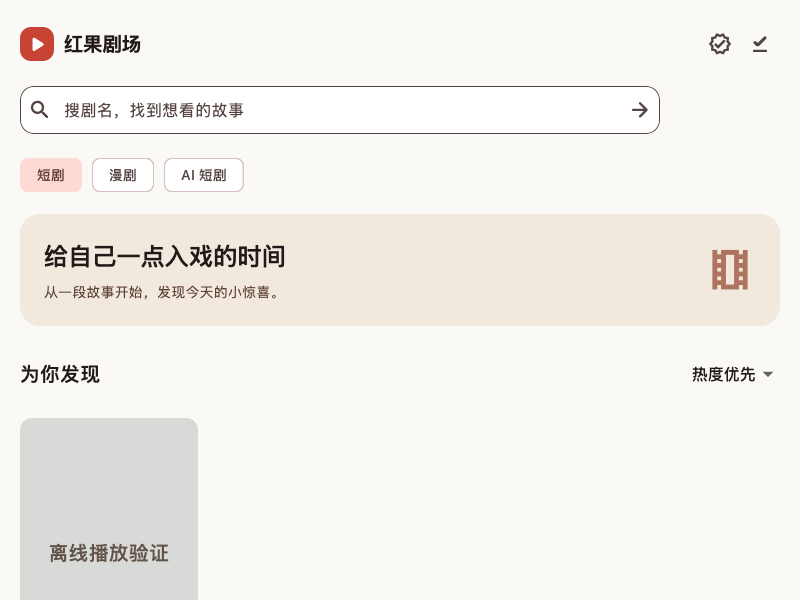
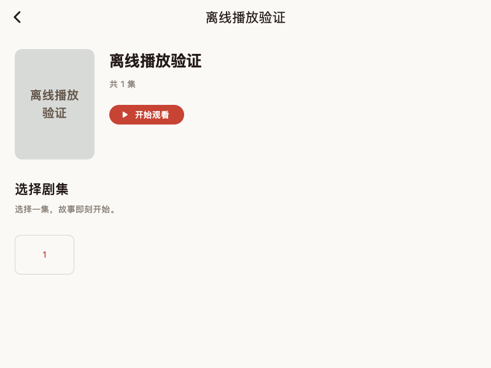
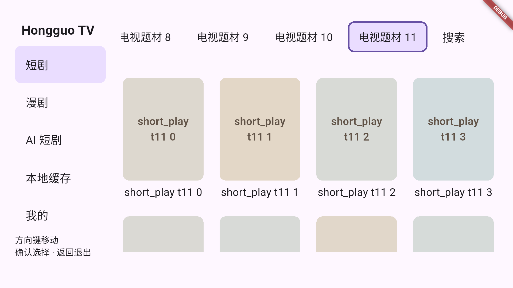

# Hongguo 短剧客户端（Flutter）

面向 Android / iOS / macOS / Windows / Linux 与 Android TV 的多端短剧客户端。签名、取址、下载、解密、缓存与播放在**设备本地闭环**，运行时不需要自建后端、Node 服务或 ffmpeg。

| 概览 | |
|---|---|
| 当前版本 | `0.3.25+37`（[最新 Release](https://github.com/skeyboy/flutter_hongguo/releases/tag/v0.3.25)：五平台 12 个安装包 + 校验清单，共 15 个附件） |
| 运行端 | Android（mobile / tv 双 flavor）· iOS · macOS · Windows · Linux · Web（远程服务适配） |
| 技术底座 | Flutter 3.47.4 / Dart 3.13.3（fvm 锁定）· Riverpod · GetIt · Dio · media_kit |
| 仓库形态 | Dart workspace 单仓多包（6 个包） |

<sub>[特性亮点](#特性亮点) · [功能](#功能) · [技术栈](#技术栈) · [架构](#架构) · [快速开始](#快速开始) · [平台支持](#平台支持) · [测试](#测试与质量门禁) · [构建与发布](#构建与发布) · [已知限制](#已知限制) · [文档](#文档) · [许可](#许可与来源说明)</sub>

## 特性亮点

- **离线可用**：分集下载后本地连播，缺集即停不误联网；重启后未完成的传输自动续传。
- **真正的多端一致体验**：一套 Dart 核心 + 自适应 UI，PC 侧栏 / 移动底部导航 / TV 遥控器三套交互形态。
- **协议自持**：请求签名、URL 解码、内容密钥解包、MP4 音视频样本 AES-CTR 解密全部为纯 Dart 实现，并做 AOT 与 JS 双端对拍。
- **本地播放管线**：media_kit 播放本地明文 MP4，清晰度切换、seek、连播、下一集预热与断点续播；可选「边下边播」让加密剧集在下载完成前先播放已解密前缀。
- **后台与悬浮**：后台播放、原生后台下载、桌面置顶小窗与系统画中画，默认全部关闭。
- **DLNA 投屏**：SSDP 发现 → SOAP 控制 → DIDL-Lite，把已缓存视频投到局域网渲染设备。
- **自更新**：以 GitHub Releases 为更新源，按平台/ABI 选件，SHA-256 校验后再安装。
- **可验证**：一条 `./tool/verify_all.sh` 跑完格式、静态分析、六包测试、双端对拍与离线媒体解密。

## 界面

| 剧目库 | 详情与选集 | 本地解密后的原生解码帧 | Android TV |
|---|---|---|---|
|  |  |  |  |

以上为离线测试样本与测试目录画面，不代表线上内容搜索结果。更多平台画面见 [docs/assets](docs/assets) 与 [验收证据](docs/evidence/README.md)。

## 功能

### 浏览与发现
首页与「我的」剧目库 · 发现/分类四层横向筛选（点击即切换，连续选择 250ms 合并请求）· 榜单独立页（一板一页 + 页头刷新）· 搜索聚焦下拉（最近搜索 + 推荐位）· 详情页紧凑布局与相关剧目 · 下滑自动续页（去重、游标停滞保护、手动重试）· 列表先渲染本地快照（`library-cache.json`）再联网刷新，失败保留缓存 · 共享异步封面（加载/失败重试/离线海报）。

### 播放
本地 MP4 播放、清晰度切换、seek、上一集/下一集、自动连播 · 播放时预热后续 3～5 集并单独预热下一集 · 本地缓存分集按集号连播，支持本地清晰度回退 · 断点续播与播放恢复对齐分集进度 · 播放页竖滑切集（触屏限定）· 控制条按「输入族 × 画面」分派：PC 与移动四态按钮簇、自绘进度条、点按/双击/长按语义、快捷键 · 边下边播（默认关闭）：边下载边把已解密片段由本地回环源喂给播放器，弱网下提前起播。

### 下载与离线
详情页分集/画质下载 · 下载管理（暂停、继续、取消、重试）· 后台下载与并发 1～5（分车道 + 调度上限）· 下载密钥入安全存储 · 本地剧目库按剧目聚合封面卡片，支持分组删除与刷新 · 手动下载独立保留，不被普通缓存清理删除。

### 投屏
设备面板、播放器内远端控制页、App 独占会话与悬浮把手；局域网媒体源向渲染设备提供已缓存的普通 MP4。

### 后台与悬浮
后台播放、原生后台下载、悬浮播放三项独立开关（默认关闭，移动端开启时说明通知/耗电/系统限制）· macOS 置顶小窗、原生画中画、遮挡不暂停、窗口生命周期与隐藏标题栏 · Android 系统画中画已验收，iOS 系统画中画当前返回不支持（见平台支持表）。

### Android TV
独立 `packages/tv` 交互模块，`--flavor tv` 构建（`applicationIdSuffix = ".tv"`）· 常驻题材水平栏（焦点切换即筛选）· 嵌套网格方向键导航与返回作用域 · 详情、我的、本地缓存、设置、下载管理均为遥控页面 · 三类内容自动续页，每页可选 30/50 条。

### 更新与设置
GitHub Releases 自更新（ETag/304 配额、忽略该版本、Android 未授权时不静默失败并下次启动补装）· 设置页涵盖缓存容量与清理、清晰度/并发/连播、全局排序、明暗主题（立即生效并保存）、会话安全保存、签名/设备与高级协议参数。

## 技术栈

**框架**：Flutter（workspace 单仓）· Dart 3.13.3 · fvm 版本锁定
**状态与依赖注入**：flutter_riverpod 3.4.3 · get_it 8.3.0
**路由**：auto_route 11.2.0
**网络**：dio 5.11.1 · background_downloader 9.6.4（原生后台下载）
**播放与音频**：media_kit 1.2.6 / media_kit_video / media_kit_libs_video · video_player · audio_service · audio_session
**密码学与协议**：crypto · pointycastle · xml（DIDL/SOAP）
**存储与安全**：flutter_secure_storage 11.2.0 · path_provider · 列表快照为 JSON 文件缓存（SQLite + 差异 patch 见设计稿，尚未实施）
**桌面**：window_manager 0.5.1（置顶小窗）· 系统 PiP
**图片**：cached_network_image
**质量**：flutter lints（`analysis_options.yaml`）· test / flutter_test · actionlint · Python 打包契约测试

## 架构

```
Flutter UI（packages/app · packages/tv）
   │  Riverpod / GetIt 装配
   ▼
hongguo_api   内容 Repository · 榜单 · 重试与请求合并 · 视频模型取址 · 播放设备注册 · 原生媒体缓存
   ▼
hongguo_core  六头签名 · URL 解码 · Spade v1 · 样本 AES-CTR 解密 · CENC 信令 · MP4 解析
   ▼
本地明文 MP4（原子缓存）── media_kit 播放 ── hongguo_cast 投屏 / hongguo_update 升级
```

| 包 | 版本 | 职责 | 平台边界 |
|---|---|---|---|
| [hongguo_core](packages/core/README.md) | 0.2.0 | 签名、密钥解包、MP4/CENC 加解密、离线诊断 | `hongguo_core.dart` 纯 Dart 且 Web 安全；`hongguo_native.dart` 才引入文件随机访问与 isolate 解密 |
| [hongguo_api](packages/api/README.md) | 0.2.1 | 内容接口、取址、重试与并发合并、媒体缓存 | 依赖 Dio；`hongguo_api.dart` 再导出了需要 `dart:io` 的设备注册模块，**不再完全 Web 安全** |
| [hongguo_update](packages/update/lib/hongguo_update.dart) | 0.1.0 | Release feed、版本比较、提示决策表、按设备选件、下载 + SHA-256 校验 | 无 Flutter，但需要 `dart:io` |
| [hongguo_cast](packages/cast/README.md) | 0.2.0 | SSDP、设备描述、SOAP、DIDL-Lite、局域网媒体源、会话状态机 | 无 Flutter，但组播与 `HttpServer` 需要 `dart:io` |
| [hongguo_tv](packages/tv/README.md) | 0.1.0 | 方向键焦点、网格与跨行导航、返回作用域、播放器状态机与画面 | 仅 Flutter；运行时与媒体由 App 注入 |
| [hongguo_app](packages/app/README.md) | 0.3.25+37 | 自适应页面、平台 runtime、播放输出、生命周期、投屏/下载/更新装配 | 六端 |

## 项目结构

```
.
├── pubspec.yaml          # workspace 成员 + 集中依赖版本（dependency_overrides）
├── .fvmrc                # Flutter 3.47.4
├── packages/
│   ├── core/  api/  update/  cast/  tv/  app/
│   ├── app/lib/          # catalog playback downloads personal ranking recommendations
│   │                     # search cast update settings navigation platform features widgets
│   └── app/integration_test/   # 真机/真窗口集成测试
├── tool/                 # 门禁与取证脚本（verify_*.sh、verify_*.py、oracle/素材生成）
│   └── ci/               # 打包计划、签名配置、桌面/Android 打包、发布校验 + 契约测试
├── docs/                 # 设计、实现与验收记录、原始分析、证据快照、截图
├── artifacts/            # 本地成品与取证留存（清理 build/ 后仍可查）
├── dist/                 # 本地打包输出
├── references/           # 上游协议参考工程（git submodule）
├── imports/              # 从原分析工程迁入的独立参考实现（不入 workspace）
├── licenses/  NOTICE.md  # 第三方许可原文与来源声明
└── .github/workflows/    # build / release / windows-verify / windows-floating-probe
```

## 环境要求

- Flutter **3.47.4** / Dart **3.13.3**（建议 `fvm use 3.47.4`，仓库已关联 `.fvm/flutter_sdk`）。**不要**在 `.fvm/flutter_sdk` 指向的共享 SDK 目录上跑 `dart format`。
- 各端原生工具链：Xcode（macOS/iOS）、Android SDK + NDK（Android/TV）、Visual Studio C++ 桌面负载（Windows）、clang/gtk（Linux）、Chrome（Web）。
- 本地开发可选：`node`（跑 JS 对拍产物）、`ffmpeg`/`ffprobe`（离线媒体校验与素材生成）、`python3`（打包契约测试与设备脚本）。
- 原生端不需要 Node 或 ffmpeg——它们只用于开发机对拍与素材生成。

## 快速开始

```bash
git clone https://github.com/skeyboy/flutter_hongguo.git
cd flutter_hongguo
fvm install                     # 或已有 SDK：fvm use 3.47.4
.fvm/flutter_sdk/bin/flutter pub get
```

运行（Android 必须显式指定 flavor，默认 flavor 已移除）：

```bash
cd packages/app

../../.fvm/flutter_sdk/bin/flutter run -d macos              # 或 -d windows / -d linux
../../.fvm/flutter_sdk/bin/flutter run -d <ios-simulator>    # iOS 无 flavor
../../.fvm/flutter_sdk/bin/flutter run -d <android> --flavor mobile
../../.fvm/flutter_sdk/bin/flutter run -d <tv-device> --flavor tv
```

其他常用参数：

```bash
# Windows 本地首次构建
../../.fvm/flutter_sdk/bin/flutter config --enable-windows-desktop

# 桌面 TV 交互预览（只切交互，不是真 flavor）
../../.fvm/flutter_sdk/bin/flutter run -d macos --dart-define=HONGGUO_TV=true

# 浏览器版：指向实现了既有路由的远程服务
../../.fvm/flutter_sdk/bin/flutter run -d chrome \
  --dart-define=HONGGUO_API_BASE=https://your-service

# 无提示重装 Android 包
python3 tool/install_android.py --device <serial>
```

App 首次运行只在私有支持目录建立设备身份与缓存目录，不读取参考工程的 `.env`、账号或数据库。

## 平台支持

| 平台 | 状态 | 说明 |
|---|---|---|
| Android（mobile） | 已验收 | 真实窗口播放、后台下载与续播、系统 PiP 已实机取证；「安装未知应用」未授权支路尚无真机读数 |
| Android TV | 已验收 | `--flavor tv`；模拟器与真实系统方向键已跑，部分遥控读数仍待补 |
| macOS | 已验收 | 真实上游单集下载 + 解密 + 1080×1920 播放 + seek；置顶小窗与原生画中画 |
| Windows | 已验收 | 构建与门禁通过；悬浮小窗集成测试有专用 workflow |
| Linux | 可构建 | CI 产出 `.deb` 与归档 |
| iOS | 部分 | 模拟器真实窗口回归通过，PiP 返回不支持、音频输出有告警；真机与签名 IPA 未闭环 |
| Web | 需远程服务 | 仅作为服务适配形态，非原生流水线 |

## 测试与质量门禁

```bash
./tool/verify_all.sh            # 全量门禁（从仓库根运行，日志落 build/verification/）
./tool/verify_native.sh macos   # 真实窗口播放/seek，使用模拟媒体响应，不请求真实上游
```

`verify_all.sh` 依次执行：`pub get` → `dart format --set-exit-if-changed packages tool` → `dart analyze --fatal-infos` → core/api/update/cast 四包 `dart test` → DIDL 严格解析（`verify_cast_didl.dart` + `verify_didl_namespaces.py`）→ tv/app `flutter test` → `tool/verify_portable.dart` 的 AOT 与 JS 双端 oracle 对拍 → `dart run tool/verify_media.dart` 离线解密（存在 ffmpeg 时再解码校验）。

两项不在 `verify_all.sh` 内，需单跑：

```bash
python3 -m unittest discover -s tool/ci/tests -v                    # 打包契约测试
cd packages/app && ../../.fvm/flutter_sdk/bin/flutter test \
  test/tv_settings_test.dart --dart-define=HONGGUO_TV=true          # TV flavor 设置面
```

设备与线上取证脚本（按需）：

| 命令 | 用途 |
|---|---|
| `./tool/verify_tv.sh [device-id]` | TV 门禁 + 遥控集成测试 |
| `python3 tool/verify_tv_device.py --device <id>` | 注入真实系统方向键 |
| `python3 tool/verify_mobile.py --platform android\|ios --device <id> --output <dir>` | 真实视口移动端集成测试 |
| `./tool/verify_mac_live.sh SERIES_ID EPISODE_VID` | Mac 真实上游单集取证 |
| `./tool/verify_download_concurrency_live.sh <device> <series> <3\|5> <log> [flavor]` | 真机并发下载取证 |
| `./tool/verify_auto_update_live.sh` | 更新链路线上读数 |
| `dart run packages/update/tool/live_feed_check.dart <from> <to>` | 已发布 feed 的可用性与选件命中 |
| `python3 tool/check_upstream_protocol.py` | 本地协议基线检查（线上探测需显式运行） |

测试样本随项目保存，普通回归不需要原 Node 工程。

## 构建与发布

打包全部在 GitHub 托管 runner 上完成；**普通 push/PR 不自动打包**，默认跳过高成本集成测试与无签名 iOS 编译。

```bash
# 手动发布（默认五个平台）
./tool/publish_github.sh                       # 或指定子集
./tool/publish_github.sh '["macos","windows"]'

# 或 Actions → release.yml → Run workflow，参数 platforms ∈
#   android | android-tv | macos | windows | linux，ios=false（默认）

# 推版本 tag 触发自动发布（轻量 tag 指向切版提交）
git tag vX.Y.Z && git push origin vX.Y.Z

# 本机 macOS 成品（需已有 Release 构建）
./tool/package_macos_release.sh
```

切版流程：同步三处版本常量（根 `pubspec.yaml`、`packages/app/pubspec.yaml`、`packages/app/lib/update/app_release.dart`）→ 补滚动发布说明 → 打指向该提交的轻量 tag。`tool/ci/release_meta.py` 会拒绝版本不一致的发布，`preflight` 会拒绝指向其他 commit 的 tag，以及未设置 `IOS_SIGNING_ENABLED` 却请求 iOS 的运行。成本与 iOS 签名配置见 [GitHub 发布说明](docs/github-release.md)。

**CI 工作流**

| 工作流 | 触发 | 内容 |
|---|---|---|
| `build.yml` | `workflow_dispatch`（默认 `["android","windows"]`）/ `workflow_call` | 构建计划 + 契约测试 → analyze 与六包测试 → 五平台原生构建 → 上传 `dist/*`（保留 1 天）；不发布 Release |
| `release.yml` | `v*` tag / `workflow_dispatch` | preflight → 复用 `build.yml` → 可选 iOS 签名构建 → 校验附件与校验和 → 发布 GitHub Release |
| `windows-verify.yml` | PR / push main / dispatch | Windows analyze + test + release 构建 |
| `windows-floating-probe.yml` | 仅手动 | 单跑 Windows 悬浮还原集成测试并留存日志 |

改动 workflow 后本地自检：`actionlint .github/workflows/*.yml`。

## 已知限制

- 仅支持**非 fragmented CENC AES-CTR**；其他容器或加密模式直接拒绝，不做兜底猜测。
- 线上内容的可用性按具体剧集验收，某一集在某端跑通不自动覆盖其他剧目、格式或平台；上游返回为空时需区分「无内容 / 签名 / 授权」三类原因，见 [上游 API 维护说明](docs/analysis/2026-10-21-upstream-api-maintenance.md)。
- Windows 侧 `packages/update` 1 项测试失败是已知旧账（临时目录句柄占用）；`packages/api` 的 9 项旧账已在边下边播改造中一并清掉（缓存身份按 basename 比较，不再依赖 POSIX 分隔符；测试清理等待作业释放句柄）。
- 「边下边播」默认关闭，只对加密剧集生效，且当前这一集会临时多占约一倍空间（密文工作文件 + 明文流式文件同时存在）；TV、画中画交接与纯离线入口不走这条链路，任何一步失败都退回整片下载后播放。
- iOS 未签名的 Release 附件中，`iOS-signing-status.txt` 就是「本轮未签 iOS」的说明。

## 路线图（未闭环项）

- 锁屏与长时间后台调度专项验收；iOS 真机与签名 IPA 发布。
- Android 未授权安装支路的真机读数；TV 遥控实际读数、详情页三端截图。
- snackbar「查看」在遥控族的可操作性、TV 主题轨标签行入口消费方。

## 文档

- [文档总索引](docs/README.md) · [文档与代码对应表](docs/project-map.md) · [验收证据](docs/evidence/README.md)
- 设计：[自动更新](docs/design/auto-update.md) · [DLNA 投屏](docs/design/cast-dlna.md) · [筛选与榜单](docs/design/discover-filters-and-ranking.md) · [播放控制条](docs/design/player-controls-redesign.md) · [剧集下载](docs/design/episode-downloads.md) · [我的与个人片库](docs/design/my-library.md) · [后台能力](docs/design/platform-background.md) · [Android TV 实施](docs/design/android-tv-implementation.md)
- 验收：[Mac 独立 App 与真实单集](docs/macos-independent-app-poc.md) · [下载解密缓存播放链路](docs/native-playback-pipeline.md) · [移动端测试与 ADB 安装](docs/mobile-testing.md) · [Android TV 模拟器](docs/android-tv-emulator-verification.md)
- 原始分析快照：[流程与签名](docs/analysis/2026-10-19_流程与签名-hongguo-report.md) · [API 文档](docs/analysis/API-reference.md) · [Dart/Flutter 可行性](docs/analysis/Flutter-Dart-feasibility.md)

## 贡献与开发约定

- 分包与依赖策略沿用 `hack-news-flutter`：成员包写 `any`，版本策略集中在根 `pubspec.yaml` 的 `dependency_overrides`；新增依赖先加到这里。
- 提交前跑 `./tool/verify_all.sh`，并单跑打包契约测试；`dart format` 与 `dart analyze --fatal-infos` 是硬门禁，PR 上另有 Windows 门禁 workflow。
- 改源码只做定点编辑，不要用脚本按行号/大括号批量删行——本项目曾因此一次误删 800 余行且难以回滚。
- 一次提交只包含本轮涉及的路径；`build/`、`.idea/`、`references/`、`imports/` 已从分析器排除。
- 切版是四处同步的机械动作（两处 pubspec + `app_release.dart` + 滚动发布说明），漏改会被 `tool/ci/release_meta.py` 拒绝。

## 许可与来源说明

仓库根未单独声明许可证。初始 Dart 协议实现改写自 hongguo-web 1.1.1（MIT，原文保留在 [licenses/hongguo-web-MIT.txt](licenses/hongguo-web-MIT.txt)）；其上游组件另有 GPL-3.0 与算法谱系归属，逐条列在 [NOTICE.md](NOTICE.md)。再分发前请按 NOTICE 核对组件许可，包级 MIT 声明不替代组件声明。

## 致谢

- [sunnysky123/hongguo-web](https://github.com/sunnysky123/hongguo-web)：协议与算法参考（以 submodule 挂在 `references/`）。
- `jackotom/hongguo-drama`、`woshishiq1/drpys`、`N3urda/hongguoTV`：签名与 Spade 算法谱系。
- `hack-news-flutter`：workspace 分包与依赖管理范式。
- media_kit、Dio、Riverpod、GetIt、auto_route 等上游库。
