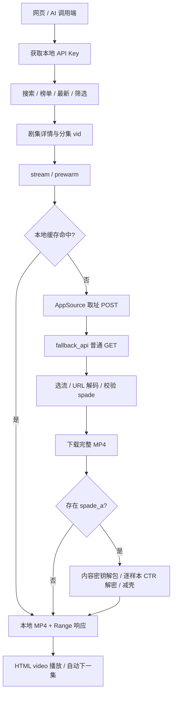

# hongguo-web 1.1.1：业务、AI 编排、签名解码与视频播放分析

分析日期：2026-10-19。对象：当前 macOS arm 包中的 JavaScript 源码。采用本地静态分析、项目离线自检和 HTTP mock，不访问上游生产接口。本文是当前实现的接口说明，不是上游官方文档；代码注释中的“实测”属于原作者记录，本次未重新在线验证。

配套：[本地与上游 API 文档](API-reference.md)、[AI 调用流程与逻辑](AI-workflow.md)。

## 1. 总体结论

这是 Node.js 内置 HTTP 服务 + 原生网页播放器，无第三方 npm 依赖。签名与视频解密在服务端本进程完成，无外部签名服务、无 unidbg 运行依赖。

“AI短剧”对应 `genre=ai_series`，是上游内容分类。本包没有 LLM、模型推理、提示词服务或 AI 视频生成管线。配套 AI 文档区分已有分类流程与建议新增的 AI 助手编排。

主链路：



## 2. 模块职责和处理顺序

| 模块 | 职责 | 主要证据位置 |
|---|---|---|
| `server/src/main.js` | 参数分流；普通启动交给 Launcher；`--selftest` 执行离线回归 | `main()` |
| `server/src/launcher.js` | 服务启动、端口/配置、浏览器和进程管理 | 启动编排 |
| `server/src/server.js` | 本地鉴权、限流、业务路由、播放响应 | `handle()`、`route()`、`handleStream()` |
| `server/src/service/client.js` | 列表/搜索/分集，上游 query 与签名、缓存、重试 | `apiOnce()`、`searchPage()`、`getEpisodes()` |
| `server/src/service/web-source.js` | 官网 SSR 数据提取，计划用于搜索与分集回退 | `search()`、`episodes()` |
| `server/src/service/app-source.js` | App 取址、fallback、清晰度选流、URL 解码 | `fetch()`、`postSigned()` |
| `server/src/core/pure-sign.js` | 六个请求签名头 | `sign()`、`branchOf()` |
| `server/src/core/spade.js` | spade_a v1 解包为内容密钥 | `unwrapV1()`、`spadeToKey()` |
| `server/src/core/mp4.js` | MP4 盒/样本索引、IV、CTR 解密、移除 CENC 信令 | `decryptTrack()`、`stripEncryption()` |
| `server/src/service/stream.js` | 缓存、下载、解密、封装、预热与并发去重 | `ensureDecrypted()` |
| `server/src/service/res.js` | JSON、静态资源和 Range 文件响应 | `streamFile()` |
| `web/app.js` | 页面状态、列表、选集、播放、收藏与历史 | `prewarmNext()`、video 事件 |

### 2.1 内容发现与分集

1. 浏览器读取服务地址与 API Key（localStorage 的 `hg_api`、`hg_key`），必要时请求 `/api-key`。
2. 通过 `/latest`、`/browse`、`/rank` 或 `/search` 得到 `series_id`。ID 必须按字符串保留，避免 JavaScript 大整数精度丢失。
3. `/episodes?series_id=...` 得到 `{meta, episodes}`；分集元素含 `index`、`vid`、`title`、`duration` 等。
4. App 详情使用签名 POST `/novel/player/multi_video_detail/preload/v1`，`data[series_id].video_data` 归一化到本地模型；详情缓存 21600 秒。
5. 搜索设计为官网优先，App 回退；详情设计为 App 优先，异常时官网回退。**当前官网实现存在异步错误，实际不能按设计回退，详见第 7 节。**
6. 搜索缓存/累积游标缓存为 600 秒；App 搜索使用 `offset`、`passback`、`search_id` 续取，过滤无集数与重复剧目。

### 2.2 AI短剧现有流程

`genre=ai_series` → `GENRES.ai_series=['ai_series','ai_series']` → 上游 `req_scene=ai_series`、`select_items.genre=['ai_series']`。列表/筛选仍调用普通 landpage 接口；进入某剧后使用相同的分集和播放器。没有独立 AI 签名或 AI 解密算法。

## 3. 三种密钥与四种不同处理

| 对象 | 来源与用途 | 处理 |
|---|---|---|
| 本地 API Key | `apikeys.json`；保护本服务数据接口 | `hg_` + 24 随机字节的 hex，直接匹配启用记录；不是可“解码”的加密凭据 |
| 管理口令 | `ADMIN_TOKEN` 或同文件 `admin_token` | 单独校验；首次缺省生成 32 随机字节 hex |
| 上游 session token/cookie | 配置 `upstream.session_headers`（如有） | 属于登录态；本项目不会自动获取新登录态 |
| 签名算法常量 | `pure-sign.js` 内常量与随机量 | 算法输入；不等于视频 content key |
| URL 派生 key/IV | `key_seed` 与固定 `URL_CONSTANTS` 派生 | AES-128-CBC 解开媒体地址字符串 |
| 内容密钥 | `spade_a` 经 v1 字节变换得到 32 位 hex | 16 字节 AES key，用于 MP4 样本 AES-128-CTR |

Base64 是编码；URL AES 解码、spade 解包和视频解密是不同阶段，不能互相替代。报告不复制本机实际 API Key、管理口令或会话凭据。

## 4. 上游签名逻辑

### 4.1 请求输入必须按最终字节确定

`client.js:buildUrl()` 按对象插入顺序合并基础参数、设备参数、额外参数及 `_rticket`（毫秒）。`buildHeaders()` 将 JSON 请求体编码为 UTF-8 Buffer，`x-ss-stub=uppercase(MD5(body))`。签名必须使用最终 URL 与同一 Buffer，签完不能重新排序 query 或重新序列化 body。

播放取址的 `AppSource.postSigned()` 使用独立设备模板：aid=8662、version_name=7.1.3.32、Android 16/Redmi，每轮生成 iid/device_id，补 `ts` 和 `_rticket`。与普通 Client 配置的 7.2.2.32、a 域名并不是同一套参数。

`pyEncode()` 只保留字母、数字和 `-_.~`，其余 UTF-8 字节编码为大写 `%XX`，特别包括 `!'()*`。不能直接认为它等价于 JS 默认 `encodeURIComponent()`。

### 4.2 六个签名头（仅描述本仓库实现）

| 头 | 本项目实现 | 主要函数 |
|---|---|---|
| `x-khronos` | 秒级时间戳字符串 | `sign()` |
| `x-ladon` | Base64(BE32(timestamp)) | `sign()` |
| `x-argus` | Base64(LE32(timestamp)) | `sign()` |
| `x-gorgon` | query/body 摘要和时间戳，经 RC4 变体与位变换 | `xGorgon()` |
| `x-helios` | 随机量+aid 摘要，64 位运算与类 Feistel 分组变换后 Base64 | `heliosWith()` |
| `x-medusa` | SM3(query)、MD5(body)、时间戳及设备信息 → hashF13/protobuf → xmxor/逆序/XOR → AesV3 → 带前缀 Base64 | `buildMedusa()` |

这里的 Argus/Ladon 简化实现不应概括为其他版本 App 的通用算法。`AesV3` 是定制变体，不可用标准 AES-CBC 直接替换。运行时必须支持 SM3，模块加载时检查 `crypto.getHashes()`。

### 4.3 分支与随机性

`branchOf()` 对 query 的 SM3、body 的 MD5（空 body 使用全零 16 字节）及 LE32 时间戳做状态混合，得到 0/1/2 分支。调用方按代码中的兼容策略尝试避开 branch=1：最多 32 次改变 `_rticket` 后重新签名。普通 Client 保留设备，AppSource 每轮还重建随机设备。原作者记录 branch=1 会被上游拒绝，本次只核对了实现与离线测试。

同样的 URL、body、时间戳也可能产生不同签名，因为包含随机量、进程 nonce 和运行环境字段。不能用“每次输出完全相同”作为签名正确性标准。当前项目仅导出 `sign`、`branchOf`，没有 HTTP `/sign` 路由。

### 4.4 可独立执行的离线检查

在项目根目录运行，不发送网络请求，也不输出真实凭据：

```bash
./node/bin/node <<'JS'
const assert = require('node:assert/strict');
const Sign = require('./server/src/core/pure-sign');
const Spade = require('./server/src/core/spade');
const t = 1700000000;
const h = Sign.sign('https://example.invalid/test?device_id=0&version_name=7.1.3.32', null, t);
assert.equal(Buffer.from(h['x-ladon'], 'base64').readUInt32BE(), t);
assert.equal(Buffer.from(h['x-argus'], 'base64').readUInt32LE(), t);
assert.equal(Object.keys(h).length, 6);
assert.equal(Spade.selfTest(), true);
console.log('签名结构、时间戳编码和 spade 真值校验通过');
JS
```

这只能验证本地结构与仓库向量，不能证明上游当前接受签名。

## 5. 视频取址、URL 解码与内容密钥

### 5.1 双请求取址

> 2026-10-28 更正：下面这条 1.1.1 流程里第 2、4 步已变。上游从 2026-10-27 起对 `/novel/player/multi_video_model/v1/` 校验设备身份并拒绝带签名的合成 ID 请求（返回 200 + 0 字节），现在先用 ttEncrypt 注册匿名播放设备、再免签 POST；新回答还会把 `video_list` 内联进 `video_model`，此时没有第二跳。见[上游 API 维护](2026-10-21-upstream-api-maintenance.md)的 2026-10-28 一节。

1. `AppSource.fetch(vid, quality)` 要求 vid 为 1–30 位数字字符串。
2. 签名 POST b 域名 `/novel/player/multi_video_model/v1/`（注意尾斜杠）。
3. 提取 `data[vid].video_model`，兼容对象或 JSON 字符串。
4. 从 `fallback_api` 解析地址，校验 HTTPS、无用户信息、443 端口、API 域白名单，再普通 GET（仅 UA，不签名）。
5. 读取 `outer.video_info.data.video_list` 与 `key_seed`。
6. 选流后依次尝试 `main_url`、`backup_url`、`backup_url_list`，解地址并校验 CDN 白名单。
7. 返回 `{url, spadeA, encrypt, definition, size}`。此对象供服务内部使用，不会把内容密钥放进本地 `/video_url` 响应。

### 5.2 URL AES-CBC 解码

有 `key_seed` 时：

```text
seed = Base64Decode(key_seed)
h1 = SHA512(seed)
h2 = SHA512(h1 || URL_CONSTANTS)
key = h2[0:16]
iv = h2[16:32]
raw = Base64Decode(candidate_url)
要求 raw[0]=0xa8、raw[2]=0x01、raw[3]=0x00
cipher = raw[4 : 4 + floor((len(raw)-4)/16)*16]
plain = AES-128-CBC-Decrypt(key, iv, cipher)，关闭自动 padding
按末字节范围 1..16 裁去尾部 padding，再裁尾部零字节，UTF-8 转 URL
```

固定 64 字节 `URL_CONSTANTS` 在 `app-source.js` 中已具名定义，不是本机用户凭据。无 seed 时仅清理转义。当前手工去 padding 没有完整验证每个 padding 字节，文档按实际实现描述。

API 白名单：fqnovel.com、snssdk.com 及子域；媒体白名单：qznovelvod.com、fqnovelvod.com、douyinvod.com 及子域。

### 5.3 选流规则

- best/auto/空值：先 H.264，再 HEVC；同编码按 quality 中解析的数字降序。
- 指定如 1080p：过滤短边小于 1080 的候选，再按短边升序、编码优先级排序。不是“精确等于 1080p”，也不是自动降级；无合适候选抛错。
- 不支持其他编码。候选有 spade 时，AppSource 先仅用 flag=0 预验证 v1 key；后续 Spade 通用接口才会尝试 flag 0/1。

### 5.4 spade_a v1 解包

入口 `Spade.spadeToKey(base64, flag=0)`：

1. Base64 得到 spade 字节数组 L。
2. `b=spade[0]^spade[1]^spade[2]`，类型长度 `n=b-0x30`，有效数据长 `m=L-b+0x2f`，做边界检查。
3. 用尾部两字节 XOR 还原类型；app_v2/web_v2 返回 null，当前不实现其 AES-GCM 路径。
4. `dest=spade[1:1+m]`；滚动状态初值 `cur14=0x55, cur16=0xfa`。
5. 对每个位置 i，按奇偶调整滚动状态，计算 `dest[i]=(c+(cur16 XOR 原字节)) & 255`；flag=0 时 `c=-0x15-popcount(i)`，flag=1 相反。
6. dest 首字符转换为裁剪量，提取 `dest[1:m-offset]` 得到 key 字符串。
7. 必须为 32 位小写十六进制，转换为 16 字节 AES key；入口失败会尝试另一个 flag。

这是字节混淆解包，不是“用固定 AES 主密钥解 spade”，无远程 key server 调用。实际能否解开某集，仍取决于其格式、返回数据和 key/媒体是否匹配。

## 6. MP4 解密与浏览器播放

### 6.1 服务端处理

`ensureDecrypted(vid, quality)`：

- 缓存键为 vid + 清晰度安全字符串，优先 `.play.mp4`，再 `.mp4`、`.raw.mp4`。
- 同一缓存输出路径使用 INFLIGHT Promise 合并任务。
- 无 spade：下载为 `.mp4` 返回；有 spade：下载为 `.raw.mp4`，原地解密。
- 定位 moov、分析各轨 sample offset/size 和 tenc/senc 信息，仅将 moov 与单样本装入解密堆内存。
- 先在视频样本上验证 key/IV 的 NAL 长度结构，再修改文件，防止先解密后验证产生假阳性。
- 视频和音频共用内容 key，但各轨使用自己的逐样本 IV；缺失时按轨回退 base IV。8 字节 IV 放计数器高 64 位、低 64 位补零，16 字节 IV 保留完整计数器。
- 对样本执行 AES-128-CTR，再移除 CENC 盒和恢复普通样本条目，修正容器布局。
- 默认纯 JS `stripEncryption()`；不适用时 ffmpeg remux；配置开启时可转 H.264/AAC。失败可能保留 raw，返回路径不保证所有浏览器都能播放。

**不是边下边解边播**：下载函数通过 Http.send 收到完整响应 Buffer 后写文件，因此首次冷启动需等完整下载、解密/封装。解密阶段低内存不代表下载阶段流式或恒定内存。

缓存默认最多保留 30 个成品，按修改时间淘汰，不是按最近访问时间 LRU。预热 4 个执行位、64 个排队位，最多尝试 3 次；队列满时当前调用等待执行，故 `/prewarm` 并非始终即时返回。

### 6.2 播放器和 Range

网页把 `video.src` 设置为 `/stream?vid=...&api_key=...`。本地 key 放 query 是为适配原生 video 不能自定义 header。服务端准备好普通 MP4 后支持 `bytes=start-end`，返回 206、Content-Range、Accept-Ranges；无 Range 返回 200。结束事件按本地自动连播开关选下一集，并预热下一集。

收藏、历史和自动连播开关保存在浏览器 localStorage，不是账号云同步。

`/video_url` 和 `/play` 返回的是上游地址，地址字符串被解码不等于视频内容已解密。正常播放应使用 `/stream`；本项目没有 HLS/M3U8 分片或浏览器 EME license 交换流程。

## 7. 代码中需要注意的问题

| 问题 | 证据/实际行为 | 影响与建议 |
|---|---|---|
| 官网函数漏 await | `web-source.js:search` 和 `episodes` 均同步调用 async fetchHtml | search 的 html 是 Promise，indexOf 抛错后返回 []；episodes 对 Promise 做正则匹配后返回 null。将两函数改 async 并 await fetchHtml，补 mock 回归；本次未修改 |
| browse 仅 offset 的续页异常 | `server.js` 分支允许 offset>0，但随后无条件 `seenRaw.split(',')` | 只传 offset、不传 seen 会抛错并得到 502；调用端同时传 seen，或修复空值分支 |
| Range suffix 语义错误 | `Res.streamFile` 将 bytes=-N 当作 start=0/end=N | 返回前 N+1 字节而非末 N 字节；不应宣称完整 RFC Range 支持；建议补 suffix/multi-range 用例 |
| 缓存完成状态未校验 | cachedPath 只检查存在且 size>0，raw 可能已失败/半解密 | 后续可能把失败 raw 当成候选重封装；建议使用完成标记/原子发布，失败清理 |
| 白名单只检查初始地址 | checkedUrl 检查入口；Http.send 默认跟随最多 5 次重定向，重定向处未重新套用该白名单 | 不能把“入口白名单”表述成全链路重定向校验；建议逐跳校验域名、协议和头转发 |
| 分页标记不统一 | 首屏 rank/latest 常无 has_more；Page.slice 依赖 upstreamHasMore | AI 不应因首屏缺标记便判断耗尽；官网本地切片可能有剩余却 has_more=false |
| refreshSession 为空操作 | client.js 中仅更新时间戳 | 登录失效时重试不等于登录态已更新 |
| 自检不覆盖官网异步问题 | 165/165 通过后，HTTP mock 仍复现该问题 | “离线测试通过”不等于搜索/回退线上可用 |

本次需求是分析与文档，未对上述问题改动业务代码。

## 8. 验证结果与可追溯证据

| Evidence | Finding | Path |
|---|---|---|
| E1：main/server/client/app-source 函数与路由 | F1：列表数据与播放取址使用不同主机、参数和业务入口 | 页面 → 本地路由 → Client/AppSource |
| E2：pure-sign.js 的 sign/branchOf/buildMedusa | F2：本地六头签名，query/body 字节敏感且含随机性 | 请求构造 → PureSign → HTTP |
| E3：spade.js、mp4.js、stream.js | F3：URL CBC、spade v1、样本 CTR 为三段独立处理 | fallback → URL → key → MP4 |
| E4：web-source.js + 本地 Http.send mock | F4：官网搜索/分集路径实际失效 | fetchHtml Promise → 同步解析 → []/null |
| E5：work/hongguo-analysis/selftest.log | F5：现有离线回归 165/165，通过不覆盖线上协议变化 | bundled Node → --selftest |
| E6：server.js /browse、res.js Range 分支 | F6：仅 offset 续页与 suffix Range 有兼容问题 | 入参 → 分支 → 错误响应/错误区间 |

执行命令：`./node/bin/node server/src/main.js --selftest`。结果：165/165 全部通过。使用随包 Node v24.22.0；ffmpeg 可用，默认转码关闭。未验证上游签名接受率、现有具体内容可播性或最新官网 HTML 格式。

离线模拟重现（将 Http.send 替换为内存响应，不外连）：

```bash
./node/bin/node <<'JS'
const Http = require('./server/src/util/http');
Http.send = async () => ({ok: () => true,
  text: () => '{"searchList":[],"vid_list":["123"]}'});
const Web = require('./server/src/service/web-source');
console.log({search: Web.search('离线测试'), episodes: Web.episodes('123')});
JS
```

实际输出含 `html.indexOf is not a function`，结果 `{search:[], episodes:null}`。

分析范围与授权记录：`work/hongguo-analysis/scope.md`。交付使用普通源码分析模板（flavor=null）。
