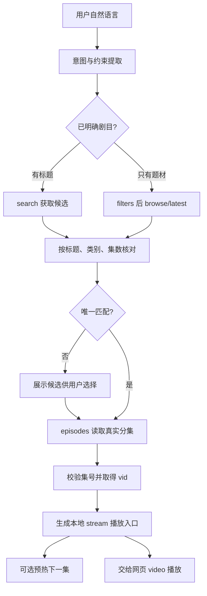

# AI 对应流程与处理逻辑

本项目没有内置 AI 推理；本文分为已实现的“AI短剧分类”和可接入 AI 助手的建议编排。建议编排尚未实现为代码或独立 HTTP 接口。

## 1. 已实现：AI短剧分类

```text
用户点击 AI短剧
→ genre=ai_series
→ /latest 或 /filters + /browse
→ Client.GENRES 映射 req_scene=ai_series / genre=[ai_series]
→ landpage 上游接口返回内容
→ 选择 series_id
→ /episodes 得到 vid
→ /stream 共用 App 取址、解密、缓存、Range 播放
```

它不负责写剧本、生成视频、训练模型或推荐模型推理。AI短剧页面中的排序/筛选由上游数据接口实现。

## 2. 建议新增：AI 助手作为接口调用编排层

AI 只负责理解用户意图、提取参数、选择剧目和解释结果；确定性的 ID 校验、签名、解码、密钥和媒体处理继续由现有后端完成。不要让模型重写签名算法或接触 content key。



### 2.1 意图与参数

建议内部规范化结果（非已有 API）：

```json
{
  "intent":"play_episode",
  "title":"用户给出的剧名",
  "genre":"ai_series",
  "filters":{"theme":"玄幻","status":"已完结"},
  "episode":3,
  "quality":"best"
}
```

建议 intent 枚举：search_title、browse_content、latest_content、list_episodes、play_episode、continue_watching、download_episode。缺失参数保留未知，不编造 series_id/vid。已知 ID 全程用字符串。

### 2.2 可提供给 AI 的工具契约

下列名称是建议的 adapter 函数，映射现有本地 API，尚不存在独立 `/ai/*` 路由。

| 建议工具 | 输入 | 映射/输出 |
|---|---|---|
| search_drama | query、limit、offset | GET /search → 候选列表与 next_offset |
| get_filters | genre | GET /filters → 可用筛选项 |
| browse_drama | genre、filters、offset、seen | GET /browse → 剧目列表；当前续页必须带 seen |
| list_latest | genre、limit、only_today | GET /latest → 最新内容 |
| get_episodes | series_id | GET /episodes → meta/episodes |
| get_playback_entry | vid 或 series_id+episode，quality | adapter 构造 /stream URL；不是调用 /video_url 后断言可播 |
| warm_episode | vid、quality | GET /prewarm → cached/warming/failed |
| download_episode | vid、quality | GET /download → 服务端 path，不是客户端文件 |

API Key 由 adapter 在 HTTP 层注入。给模型的结果可用本地不透明播放句柄替代带 key 的 URL，最终由 UI 构造 video.src，避免将凭据写入模型日志。

### 2.3 状态机与判定

```text
INIT → DISCOVER → SELECT → RESOLVE_EPISODES → READY → PREPARING → PLAYING
                         ↘ NEED_SELECTION
任一网络步骤 → RETRYABLE_ERROR / INPUT_ERROR / AUTH_ERROR / UNAVAILABLE
PLAYING → ENDED → 下一集（用户已启用自动连播时）
```

- INIT：检查本地 health，adapter 获取/持有 key。
- DISCOVER：有准确标题用搜索；只给题材先查 filters，再 browse；“最新AI短剧”用 latest(ai_series)。
- SELECT：同名多剧时展示标题、集数、封面供选择，不根据模型记忆猜 ID。
- RESOLVE_EPISODES：从返回数组按 index 取 vid；不能把集号当 vid，不能由上一集 vid 数值推算下一集。
- READY：建立 stream 入口。网页选择播放后才开始媒体任务，避免对所有候选预热。
- PREPARING：首播可能等待完整文件下载与解密；prewarm=warming 不是完成信号。当前没有独立 `/prewarm/status` 轮询接口。
- PLAYING：依据 video 的 playing/error/ended 等事件判定；HTTP 200 或文件存在不等于已成功解码播放。
- CONTINUE：历史在浏览器 localStorage，需前端主动提供；现有服务没有用户播放历史接口。

### 2.4 错误处理

| 情况 | AI/adapter 行为 |
|---|---|
| 搜索为空 | 先说明未查到；当前官网路径有漏 await，App 搜索还可能缺登录态，不能说“该剧不存在” |
| 本地 401 | 由 adapter 核对本地 key；若是上游登录失效，提示需要有效会话配置，不反复申请本地 key |
| 429 | 退避、停止并发翻页/预热，不持续轮询 |
| 502 | 展示服务端 detail，限定重试，不承诺换集/提清晰度能解决 |
| 集号超范围 | 使用实际 episodes 列表解释可用集数 |
| 多候选同名 | 要求选定候选后继续 |
| unsupported spade v2 | 标注当前后端不支持；不能声称 v1 算法适用于全部内容 |
| HEVC 播放失败 | 检查编码兼容性，可考虑后端 H.264 转码配置；best 已优先 H.264，但不保证存在 |
| `/download` 成功 | 明确文件在服务器路径，不说“已下载到用户设备” |

## 3. 示例：查找并播放 AI 短剧第 3 集

```text
用户：“找一部玄幻 AI 短剧，播放第三集。”
1. 解析 genre=ai_series、theme=玄幻、episode=3。
2. get_filters(ai_series)，确认题材项；browse_drama 返回候选。
3. 展示候选供用户选剧，拿到真实 series_id。
4. get_episodes(series_id)，查 index=3 是否存在，取对应 vid。
5. UI 构造 /stream?vid=...&quality=best&api_key=... 并设置 video.src。
6. 后端执行签名→fallback→URL解码→下载→必要的内容解密→封装。
7. video 触发 playing 后显示“正在播放”；可预热 index=4 的真实 vid。
```

## 4. 建议实现顺序与验收

1. 先修官网漏 await、browse 续页空值；对现有接口补 mock 回归。
2. 建立小型 adapter：参数 schema 校验、凭据注入、ID 字符串保留、超时和错误分类。
3. 接入模型意图解析与工具选择，不改变签名/解码媒体层。
4. 在 UI 接入候选确认、播放器事件与本地历史读取。
5. 离线 mock 验证同名选择、超范围、空列表、401/429/502、warming/failed、视频 error；联网验收另行区分。

验收必须区分：工具调用成功、取到播放信息、完成解密、浏览器真正播放四个阶段。当前离线 165/165 自检仅覆盖其中部分底层逻辑。
