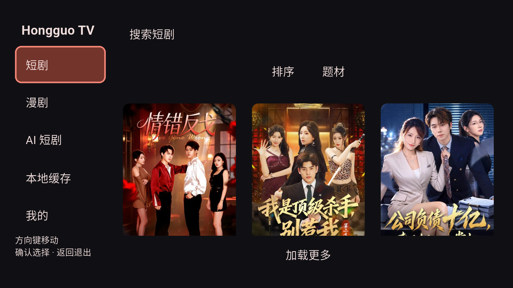

# Android TV 模拟器运行与系统遥控验证

> 后续修复：已启用 AVD 的 qwerty2 键盘/D-pad，并追加模拟器控制服务 evdev 通道验证；此前 ADB 注入通过不足以覆盖模拟遥控器。详见 [模拟遥控器修复](android-tv-remote-fix.md)。

日期：2026-10-20。

## 结果

已按用户要求删除原 `yxy_verify` AVD 及其设备数据，重新创建并启动 **`hongguo_tv_api34`**，使用官方 Android TV 系统镜像；正常 TV App 已安装并保留在前台，模拟器窗口保持运行。

| 项目 | 实际记录 |
|---|---|
| 系统镜像 | `system-images;android-34;android-tv;arm64-v8a` |
| 系统 | Android 14 / API 34 |
| 设备模板 | tv_1080p |
| 模型 | sdk_google_atv64_arm64 |
| 显示 | 1920×1080，320 dpi |
| ADB | emulator-5554 |
| 系统特性 | android.hardware.type.television、android.software.leanback、leanback_only |
| UI mode | 0x24，低位 4 为 television |
| App | com.example.hongguo_app.tv，正常 lib/main.dart 入口 |

## 验证

`tool/verify_tv_device.py` 在主机监听原生集成测试的按键请求，使用 `adb shell input keyevent` 注入实际 Android 系统事件；没有把 Flutter 内部模拟 KeyEvent 当成本次系统遥控验证。

执行了 9 次系统按键：`22, 20, 23, 23, 22, 23, 19, 4, 4`，对应右、下、确认、确认、右、确认、上、返回、返回。

结果：目录 → 分集详情 → CENC 下载/解密 → media_kit 本地视频播放 → 进度预览与 seek → 打开/关闭控件 → 返回详情，全部通过。

```text
TV_NATIVE_PASS duration_ms=1523 audio_tracks=1 remote_seek=true
00:09 +1: All tests passed!
```

9 项 TV module 测试、1 项 App TV 目录/焦点恢复回归均通过；修改后的模块和原生集成用例静态分析无问题。

实测修复：`TvNavigation` 的纯事件容器原先也参加方向遍历，真实 D-pad 会把焦点移至无操作的容器。已通过 `canRequestFocus=false` 和 `skipTraversal=true` 排除该目标；后续真实系统方向键进入排序/卡片，确认进入详情，Back 正确恢复播放和详情焦点。

## 复现

在仓库根目录：

```bash
python3 tool/verify_tv_device.py --device emulator-5554
```

该命令使用测试入口。验收结束后已重新构建并安装正常入口，而不是把集成测试应用留给用户。

```bash
cd packages/app
HONGGUO_TEST_ABI=arm64-v8a ../../.fvm/flutter_sdk/bin/flutter build apk --debug --flavor tv --target-platform android-arm64 --target lib/main.dart
```

原始日志、系统特性、9 次按键记录、截图、构建/安装记录位于 `build/verification/tv-emulator/`。当前常规调试 APK 位于 `artifacts/android-tv/Hongguo-0.2.7-tv-arm64-debug.apk`。

## 当前运行截图



## 边界

本次补齐 Android TV **系统模拟器**验收，替代此前只在手机系统镜像上验证的限制；实体电视、实体遥控器、HDMI 输出、HEVC 硬解、长时间稳定性和商店发布仍需独立测试。只删除了用户指定的旧 AVD，连接的实体设备未操作。为释放创建空间清理了可重建 TV/mobile debug 中间文件，源码和安装包保留。
