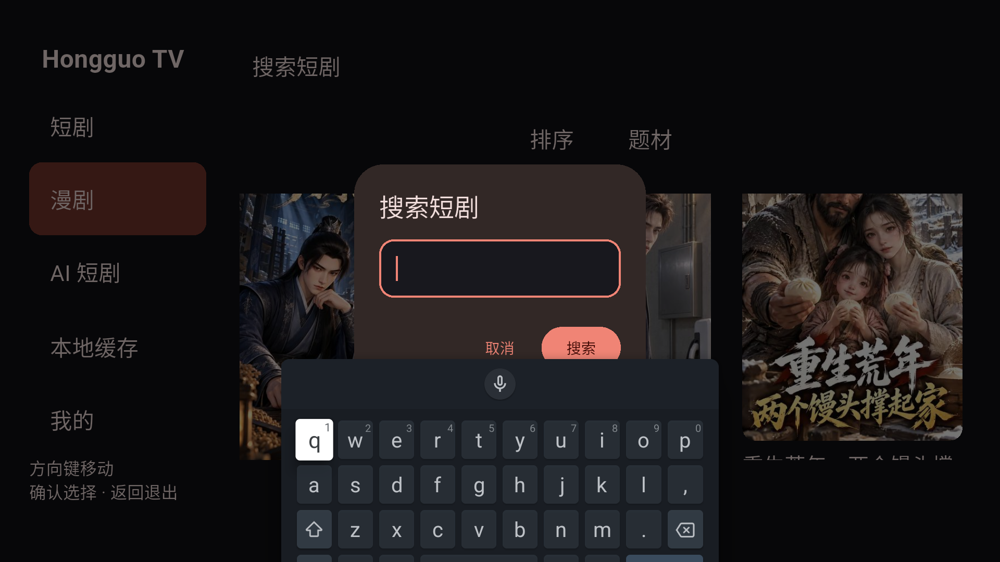

# 模拟遥控器无响应：修复与验证

日期：2026-10-20。模拟器：hongguo_tv_api34，Android TV API 34 arm64。

## 原因与修复

复现了用户反馈：App 在前台，ADB 注入方向键可用，但模拟器硬件输入通道无效果。检查修复前的 Android 输入设备，只有 gpio-keys 电源键设备；AVD 配置是 `hw.dPad=yes`、`hw.keyboard=no`。

保留模拟器数据，修改以下配置后冷启动：

```ini
hw.dPad=yes
hw.keyboard=yes
hw.keyboard.lid=no
```

重启后 Android 识别出 `qwerty2` 键盘/D-pad，硬件事件可进入 `/dev/input/event1`。本次问题的修复位于 AVD 硬件配置，不需要替换 App 的遥控器业务映射。

配置检查已保存为工具：

```bash
python3 tool/configure_tv_remote.py --avd hongguo_tv_api34
# 重新创建 AVD 后，如检查未通过，在停止模拟器后应用配置，再冷启动
python3 tool/configure_tv_remote.py --avd hongguo_tv_api34 --apply
```

配置变更会备份原 config.ini，不清除 App 或设备数据。当前模拟器已完成变更并重启。

## 验证路径

补充 `tool/emulator_remote.py`，调用本机模拟器控制服务 `sendKey`，发送 evdev 硬件按键。此通道产生实际内核输入事件；旧 console `event send` 在本机这套 virtio 设备上没有产生输入，不再将 console 返回 OK 视为按键通过。

实测 `getevent` 记录了 KEY_RIGHT、KEY_REPLY（该设备映射为 DPAD_CENTER）、KEY_BACK 的 DOWN/UP。方向、确认与返回不是仅由 Flutter 测试框架内部模拟。

9 次硬件按键执行完整目录→详情→CENC 解密→本地播放→seek→控件→返回详情链路，结果：

```text
TV_NATIVE_PASS duration_ms=1523 audio_tracks=1 remote_seek=true
00:09 +1: All tests passed!
```

正常入口 App 已恢复安装，额外用硬件按键打开了实际首页的搜索对话框/输入法；模拟器与 App 保持运行。截图见下。没有直接操作宿主 Qt 遥控器按钮，自动验证使用其模拟器控制/硬件输入路径，并以 Android 内核事件确认到达。



原始证据：

- `build/verification/tv-emulator/hardware-verification.log`
- `build/verification/tv-emulator-hardware/system-keys.json`，9 条来源为 emulator-grpc-evdev
- `build/verification/tv-emulator-hardware/kernel-events.log`
- `build/verification/tv-emulator-hardware/normal-*.png`

## 复现命令

硬件控制验证需要可选的主机 gRPC 测试依赖，与 Flutter App 无关。本次安装在项目忽略的测试 venv 中。模拟器认证信息只从本机运行记录读入内存，不写入源码或验证日志。

```bash
build/verification/tv-remote-venv/bin/python tool/verify_tv_device.py \
  --device emulator-5554 --input-source emulator \
  --output build/verification/tv-emulator-hardware
```

测试会使用集成测试入口；结束后应重新安装正常入口 APK。本次已恢复 `artifacts/android-tv/Hongguo-0.2.7-tv-arm64-debug.apk`。

实体电视/遥控器与其他宿主机的模拟器配置仍需各自验收，本记录不扩大到尚未测试的设备。
