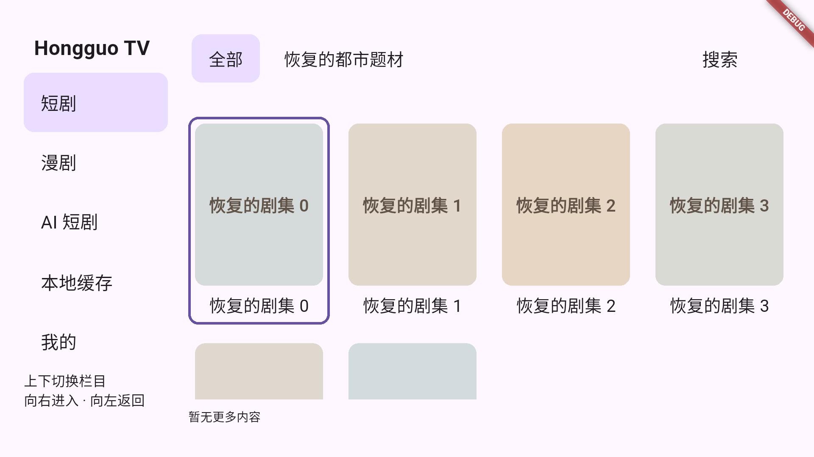
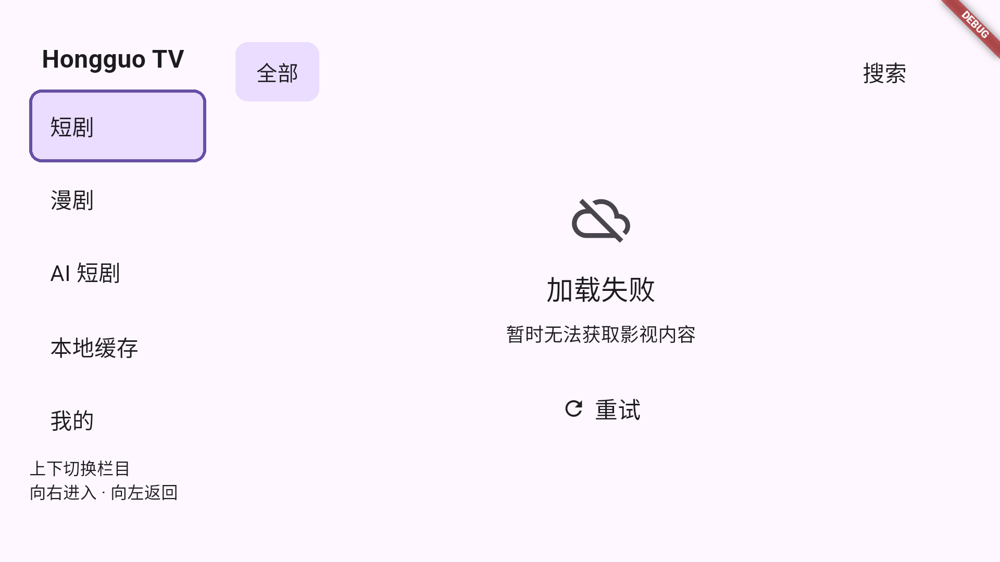

# 题材与影视列表的网络失败恢复

2026-10-20，项目 `/Users/lee/Desktop/flutter_hongguo`。原生端目录 API 默认首次请求失败后重试 3 次（最多请求 4 次）；依次等待 1 秒、2 秒、4 秒再试。默认连接、发送、接收超时为 60 秒。

## 问题与修复依据

| 代码证据 | 导致的问题 | 修改路径 |
|---|---|---|
| TV `_initialize` 捕获题材异常后返回空数组，只注册一次页面 | 题材失败伪装成“没有题材”，既没有错误提示也不能恢复 | `features/tv/tv_library_page.dart`：独立的加载/失败状态及遥控“重试题材”入口 |
| 初始路由等待题材请求结束才创建 | 题材慢时连“全部”的影视列表也无法开始加载 | 同步注册全部/搜索页，后台独立加载题材 |
| `CatalogClient._api` 无重试，且 `_queue` 等待完整网络响应 | 一次超时或临时 5xx 直接显示失败，并阻塞其他类型请求 | `api/src/network_retry.dart` 提供有限重试；队列只限制请求启动间隔（260ms） |
| 默认超时 30 秒；官网读取另硬编码 20 秒 | 弱网较容易提前终止请求，设置不能一致应用 | `core/config/app_settings.dart` 默认 60 秒；目录 API/官网回退均读取设置 |
| auto_route 默认 IndexedStack 的 tabsHash 在扩展路由时改变 | 题材恢复后，已有列表或搜索页可能被销毁重建 | 自定义 `AutoTabsRouter.builder` 保留已访问页，稳定路由索引及页面 key，同帧恢复逻辑选中页 |

以上是代码路径及可控故障测试确认的原因；没有将某个未知线上片源或服务器的具体失败归因于已确认的服务端故障。

## 重试规则

连接失败、连接/发送/接收超时、HTTP 408、429、5xx 自动重试。429 的整数秒 `Retry-After` 最长等待 30 秒。题材/影视列表缺少必要数组时也重试；合法的空数组仍视为成功，不因“暂无内容”重复请求。

取消请求、证书错误、HTTP 权限/认证错误及无效输入不会自动重试。目录接口的业务失败和 JSON 格式异常也按相同上限重试；全部三次重试耗尽后才向页面抛出错误，并保留手动入口；续页失败保留已展示条目与原 cursor，避免无限自动翻页循环。刷新期间已有缓存保持展示，最终结果仍按原数据捏合逻辑更新。

每次尝试重新生成签名、时间戳和 POST 数据流，重试保留原题材、排序、页大小、cursor、seen 参数。重试只用于已有的只读目录接口（虽然部分接口使用 POST），未扩展到写操作或媒体下载任务。

超时是每个请求阶段的限制，并非整个加载流程的总时限；持续断网时，4 次请求可能耗时较长。设置仍允许 10–120 秒。旧设置中的原默认 30 秒升级为 60 秒，其他已有值保留；保存时记录 `networkPolicyVersion: 1`，升级后用户再次明确选择 30 秒也会按 30 秒执行。

## 分层

- Core：超时默认值与范围验证。
- API：请求节流、签名重建、临时失败分类与有限重试，PC/移动/TV 原生端共用。
- App：旧偏好迁移；TV 题材状态、恢复入口、保留 auto_route 页面与数据。
- TV module：继续提供通用焦点/遥控控件，不包含网络请求或服务端协议。

## 验证与复现

API 故障测试覆盖超时两次后成功、503 恢复、持续故障在首次请求加三次重试后封顶、之后可恢复、401 不重试、目录业务失败重试三次、取消/证书不重试、429 等待上限、POST 流及签名重建、60 秒/自定义超时，以及慢题材不阻塞列表。App 测试验证题材晚到或手动重试不销毁已有列表，搜索中的补齐也不丢查询与页面状态。偏好测试覆盖旧默认迁移与之后手动选择 30 秒的持久化。

Android TV API34 故障注入测试使用实际 CatalogClient/Dio：题材两次超时后第三次成功，列表一次 503 后第二次成功，恢复后使用模拟器硬件遥控进入资源卡片。使用可控响应验证恢复机制，不代表所有线上接口均已验收。

在项目根目录复现模拟器测试：

```bash
build/verification/tv-remote-venv/bin/python tool/verify_tv_device.py \
  --device emulator-5554 --input-source emulator \
  --test integration_test/tv_network_recovery_test.dart \
  --output build/verification/tv-network-recovery-device
```

日志：`build/verification/catalog-retry-api-all.log`、`catalog-retry-app-all.log`、`catalog-retry-core-all.log`；原生证据：`build/verification/tv-network-recovery-device/`。

最终结果：API 44 项、Core 116 项、App 106 项通过；API/App 静态分析无问题；上述 Android TV 原生故障恢复及遥控操作验证通过。




## 首屏失败占位位置修复（2026-10-20）

原先首屏失败与续页失败都绘制在 40px 底部状态栏，导致空列表下方出现很小的“加载失败 · 重试”。现在空列表的加载、暂无内容、失败状态统一在右侧资源区居中展示；失败包含图标、标题与可遥控的重试按钮。已有缓存/条目时，刷新或续页失败保留原列表，使用不占位的重试浮层，不改变网格几何与滚动位置。

新增控件测试验证居中位置、完整内容区、前三次失败不展示错误、第四次仍失败才展示占位，以及手动重试后恢复数据。故障注入测试入口：`integration_test/tv_placeholder_retry_test.dart`；证据目录：`build/verification/tv-placeholder-retry-device/`。

本轮 App 111 项、API 44 项通过，静态检查无问题；原生模拟器通过首次请求加三次重试、居中位置、错误延后展示及遥控手动重试验证。




## 有数据时静默加载与底部空间（2026-10-20）

已有影视条目时，刷新/自动续页不显示“正在加载”“正在更新”，也不显示列表末尾提示。移除固定 40px 状态栏，外层 TV 页面下边距从 28px 调为 12px，网格增加 56px 的可用高度。

刷新/续页失败后，重试入口以底部小型浮层呈现，不改变网格尺寸或滚动位置。首屏无数据的加载/空/失败占位仍在完整资源区居中。回归测试验证静默加载、错误浮层出现/消失及重试成功时网格尺寸与状态一致。
