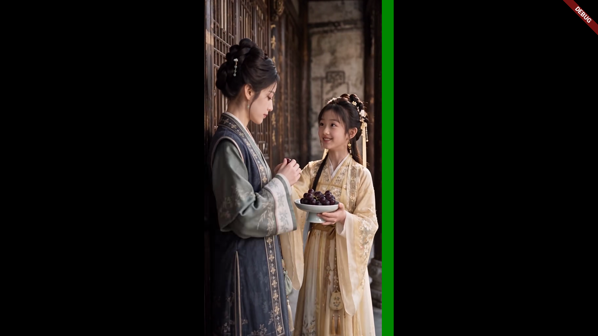
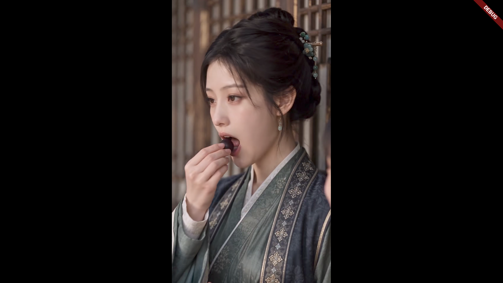
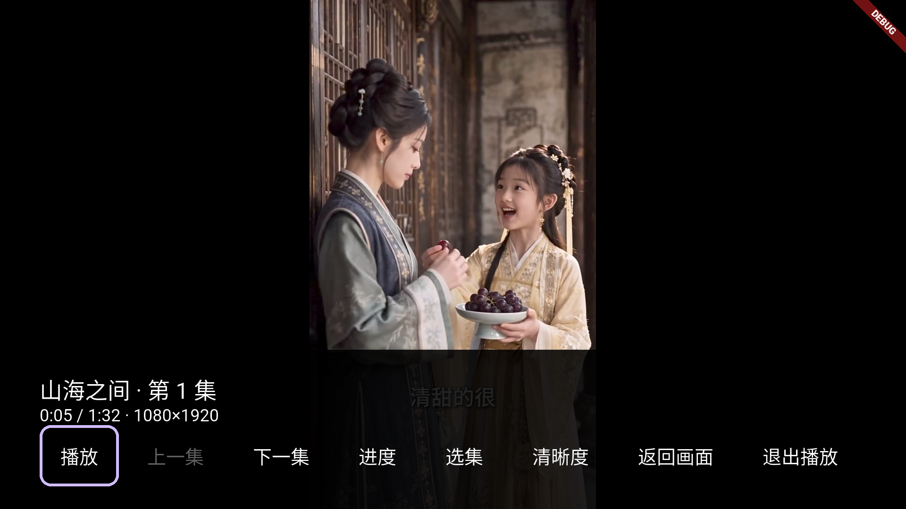
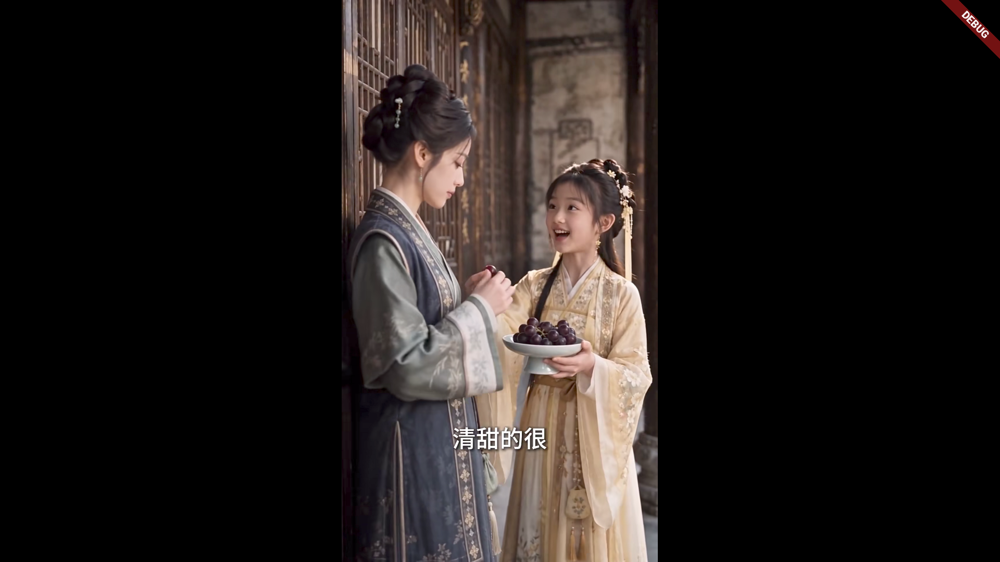

# TV 视频右侧绿色矩形分析与修复

2026-10-20。项目 `/Users/lee/Desktop/flutter_hongguo`，验证设备 `hongguo_tv_api34`，Android TV API34 / arm64 / 1920×1080。当前 `video_player 2.11.1`、`video_player_android 2.12.2`。TV 业务播放器现已显式使用 `VideoViewType.platformView`。

## 已确认的结论

问题定位在该模拟器上 **HEVC 视频经 Flutter textureView 输出** 的兼容链路。同一个已经解密的本地 MP4，在 Android 原生 platformView 中画面正常。源文件的软件解码没有绿条。现有 AspectRatio 为源视频真实的 9:16，增加黑边或强行裁掉画面会掩盖缺陷并丢失内容。

| 输入与渲染路径 | 截图整高绿色列 |
|---|---:|
| 原始 HEVC，修复前实际 App | 38px，x=1226–1263 |
| 同一 HEVC，Flutter textureView | 38px，x=1226–1263 |
| 同一 HEVC，Android platformView | 0 |
| 同一内容转 H.264，textureView | 0 |
| 同一内容转 H.264，platformView | 0 |
| 原始 HEVC，经 FFmpeg 软件解码取帧 | 0 |

原始片源：HEVC Main、1080×1920、yuv420p、SAR 1:1、Level 6.2（ffprobe level=186）。日志选中 `c2.android.hevc.decoder`，并报告 `Format exceeds selected codec's capabilities`。该警告值得作为兼容信号，但原生视图使用相同片源仍正常，所以不能将警告单独当作绿色矩形的直接根因。

## 原理与证据边界

修复前 `playback/tv_video_view.dart` 没有指定 viewType，使用默认的 Flutter 纹理路径。Flutter 官方 [SurfaceProducer 文档](https://api.flutter.dev/javadoc/io/flutter/view/TextureRegistry.SurfaceProducer.html) 指出，部分输出后端不自动处理裁切与旋转元数据；Android 的 [MediaCodec 文档](https://developer.android.com/reference/android/media/MediaCodec) 则区分解码缓冲区布局与有效图像裁切区域。

绿色矩形表现与纹理采样到解码缓冲区的对齐填充区域吻合。A/B 已确认问题路径；底层具体是哪一层丢失了 crop/stride 元数据，尚未通过原生 buffer 取证确认。不能仅凭截图推断某个 stride 数值，也不能把模拟器结果直接泛化为全部实体电视必现。

## 建议的修复方案

优先在 TV 播放渲染适配层使用 `VideoViewType.platformView`，保留现有 Runtime、解密、缓存和播放控制接口。该路径已在同一异常片源上验证消除绿条。正式集成时需回归遥控底栏叠加、焦点、切集、清晰度、进度、后台恢复与多级返回，并在实体电视验收。

H.264 可作为有对应轨道时的兼容备选，但不建议所有视频都先转码，也不建议硬裁切右侧或缩放放大来遮住绿条。HEVC 高级别兼容提示应与播放能力选择结合处理。

最初 A/B 阶段只用于诊断。后续修复现已落到业务 `TvPlaybackController.open`：创建 VideoPlayerController 时显式指定 `VideoViewType.platformView`，下载、解密、缓存及播放状态源保持原有分层。

## 复现证据

- `integration_test/tv_green_diagnostic_test.dart`：同设备、同片源对比两种渲染方式及 H.264 对照。
- `build/verification/tv-green-diagnostic-device/system-dpad-test.log`：四种组合均完成初始化、seek、播放、暂停与截图。
- `build/verification/tv-green-diagnostic-device/pixel-analysis.json`：逐列统计绿色像素，整高覆盖率大于 90% 才计入绿条。
- `build/verification/tv-green-logcat.txt`、`tv-green-source.mp4`、`tv-green-software-frame.png`：原始运行日志、当前缓存文件副本及软件解码取帧。输入视频保留在忽略的验证目录中，不加入源码资源。

诊断输入在 App 私有目录中提前准备为 `files/tv-green-hevc.mp4` 和 `files/tv-green-h264.mp4`，第二份为同内容的 H.264 对照。缺少输入时该诊断用例跳过。本次输入副本已保留在验证目录，可在项目根目录准备设备文件并复现：

```bash
adb -s emulator-5554 push build/verification/tv-green-source.mp4 /data/local/tmp/tv-green-hevc.mp4
adb -s emulator-5554 push build/verification/tv-green-h264.mp4 /data/local/tmp/tv-green-h264.mp4
adb -s emulator-5554 shell run-as com.example.hongguo_app.tv cp /data/local/tmp/tv-green-hevc.mp4 files/tv-green-hevc.mp4
adb -s emulator-5554 shell run-as com.example.hongguo_app.tv cp /data/local/tmp/tv-green-h264.mp4 files/tv-green-h264.mp4
build/verification/tv-remote-venv/bin/python tool/verify_tv_device.py \
  --device emulator-5554 --input-source emulator --allow-no-keys \
  --test integration_test/tv_green_diagnostic_test.dart \
  --output build/verification/tv-green-diagnostic-device
```





诊断阶段完成四种组合，恢复过原 APK；下述正式修复验证使用实际 TvDetailPage → PlayerPage → TvPlaybackController 链路。


## 正式播放器修复验证

- 原始 1080×1920 HEVC 片源，经生产播放器输出，纯画面、底栏叠加和真实 Home 后返回画面都无绿条。
- 像素验收：三份截图的整高绿色列均为 0，非黑像素比例分别为 30.13%、24.22%、30.15%，排除了“黑屏也算无绿条”的误判。
- 原生视图能正常显示 Flutter 遥控底栏；向上隐藏底栏后可继续观看；真实后台/恢复保留暂停状态与进度；实体返回键仅返回详情，没有遗留视频表面遮挡详情。
- 8 项菜单的原生遥控回归通过，包括上下集、进度提交/取消、选集、清晰度切换保留暂停和位置、返回画面及单层退出。
- App 122 项回归测试通过，涉及修改的文件静态检查通过。

证据：`build/verification/tv-hevc-platform-device/`（含 `pixel-verification.json`）、`build/verification/tv-hevc-platform-lifecycle.json`（实际 Home/Resume 操作）、`build/verification/tv-platform-menu-device/`。HEVC 回归入口为 `integration_test/tv_hevc_platform_test.dart`；本次运行编排保存在 `build/verification/run_hevc_platform.py`。





原生视图的分集续播、完成后从头、自动下一集及磁盘持久化复验通过：`build/verification/tv-platform-resume-device/`。

修复后的正常入口 TV APK 已构建并安装到模拟器，应用已启动。设备诊断副本已清理。
