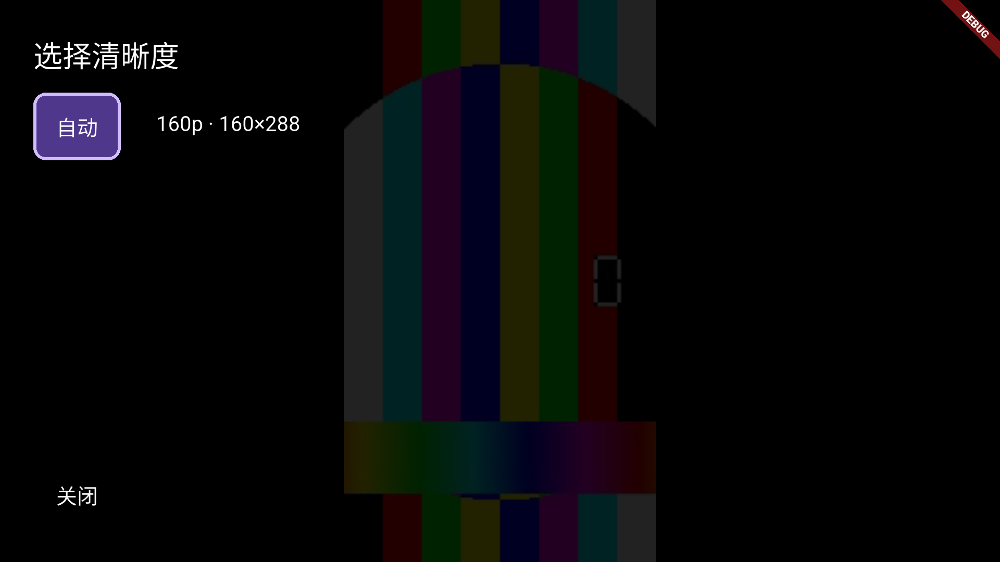

# TV 播放画面与遥控修复

2026-10-20，项目 `/Users/lee/Desktop/flutter_hongguo`。

TV 改用 `video_player` 的 Android 原生 ExoPlayer 后端，绕开模拟器中失败的 libmpv EGL 输出链路；下载、纯 Dart 解密、缓存租约、清晰度准备及预加载仍由共享 Runtime 提供。

## 复现证据与修复位置

| 证据 | 问题 | 最终处理 |
|---|---|---|
| 播放时间推进但全黑；日志 `Could not create EGL context` / `EGL_BAD_ATTRIBUTE` | 原播放器的视频输出失败，时间推进不能证明有画面 | `playback/tv_video_view.dart` 提供 TV 原生播放器适配与画面组件 |
| 图像尺寸、Texture 存在时截图仍全黑 | 原验收缺少真实像素检查 | 原生集成保留实际彩色测试图截图，并验证切集后仍显示图像 |
| 错误文字叠加并挤占屏幕 | 复用 PC 错误遮罩与 TV 遮罩导致重复 | TV 仅使用 `TvPlayerSurface` 的错误与加载界面 |
| 出错时按方向键无法打开控制栏 | 错误分支屏蔽控制入口 | 允许重试、上一集/下一集、打开选集与退出 |
| 浅色主题下播放控件文字不可见 | Theme 没有覆盖继承的文字颜色 | TV 播放层明确使用白色文字 |

`PlayerPage` 在 TV 上只从 `TvPlaybackController` 获取 position、duration、playing、completed 和 error，遥控暂停、进度与画面使用同一个状态源；后台时暂停，退出/换集时先关闭播放器再释放媒体缓存租约。代次校验防止旧初始化覆盖新集。PC/手机继续使用原 media_kit 路径。

## 验证与复现

测试使用项目内合成 CENC 样本，运行共享解密链路，再以模拟器真实硬件遥控输入完成目录 → 详情 → 播放 → 进度 → 下一集 → 返回。验收截图已显示彩色测试图，不把仅存在 Texture 或时长大于零当作画面通过。首集与切集后的中央视频区域分别经过像素检查，彩色像素占比均为 90.08%；暂停/继续、进度跳转和下一集使用硬件遥控通道验证通过。

```bash
build/verification/tv-remote-venv/bin/python tool/verify_tv_device.py \
  --device emulator-5554 --input-source emulator \
  --output build/verification/tv-player-final-device
```

正常入口也已打开真实目录视频，确认出现实际画面，记录在 `build/verification/tv-normal-detail-final.png`。模拟器的硬件解码画面边缘仍可能出现设备特有的色块，需要物理电视继续验证解码兼容性。

最终证据保存在 `build/verification/tv-player-final-device/`；初次 ExoPlayer 画面证据在 `build/verification/tv-player-exoplayer-device/`。模拟器保留原数据，已启用图形后端。可用 `python3 tool/configure_tv_remote.py --avd hongguo_tv_api34 --graphics` 检查设置；修正设置需先停止模拟器，再加 `--apply` 执行。物理电视机型和上游每条视频的可用性需分别验证；网络或格式错误会显示可操作的失败界面。


Android 后端使用 [Flutter video_player_android](https://github.com/flutter/packages/tree/main/packages/video_player/video_player_android)。


## 遥控返回越级修复

返回路径需要单一所有者。原实现同时存在播放器 Focus、内层 `TvNavigation` 的 `Navigator.maybePop`、系统返回/`PopScope` 和异步 `_exitPage`，且旧退出任务没有检查原路由是否仍在栈顶。这些路径可能重复处理返回并连带弹出详情。

最终处理：

- TV Activity 消费实体 `KEYCODE_BACK` 的 down/up；只在一次有效的 up 上交给 Android/Flutter 系统返回，忽略长按重复和取消事件，不再同时送入 Flutter 焦点按键链。手机 flavor 不受此分支影响。
- `TvBackScope` 使播放器内部按钮组将键盘返回交给播放器层级状态，不自行选择 Navigator。系统返回仍由 `PopScope` 控制一次只关闭当前层。
- `TvPlayerSurface` 的退出操作仅触发一次；显式“退出播放”允许退出路由，不会只关闭控制栏。
- `PlayerPage._exitPage` 增加在途保护并捕获原路由，等待下一帧后只有原路由仍是当前路由才允许 pop。

画面层返回详情，详情返回目录；选集面板、进度预览、控制栏先关闭本层。返回目标由进入时的实际路由栈决定，不硬编码跳首页。

App 102 项、TV 模块 16 项测试通过。原生硬件返回验证增加路由观察器：首次从纯视频返回仅记录 `/tv/player`；重新进入并逐层返回后，才记录 `/tv/detail/123`。也覆盖重复/快速按键、系统返回、内层面板与显式退出按钮。

```text
TV_BACK_NATIVE_PASS one_back_one_route=true detail_before_catalog=true
```

证据：`build/verification/tv-back-device/`；复用 `tool/verify_tv_device.py` 运行 `integration_test/tv_remote_test.dart` 可复现。


## 播放底部菜单补齐（2026-10-20）

菜单改为稳定的单行焦点顺序；左右键逐项移动并自动滚入可见区域，确认键调用当前操作。焦点暂落在播放器根节点时仍可恢复当前菜单操作。上一集/下一集在边界禁用并跳过，切集后原焦点项变成不可用时恢复到播放按钮。加载中不响应打开控制栏，避免确认键使加载状态异常。

| 菜单 | 行为与数据 |
|---|---|
| 播放/暂停 | 控制实际 TV 播放器，标签跟随 playing 状态 |
| 上一集/下一集 | 按当前剧集索引切换媒体，首尾禁用 |
| 进度 | 展示当前位置、总时长及预览进度条；左右每次 5 秒，确认提交、返回取消；随后回到进度菜单 |
| 选集 | 显示总集数、剧集标题与当前集标记，初始焦点定位当前集；确认后切换播放 |
| 清晰度 | 从服务端真实可播放视频轨道提取分辨率，去重并过滤不支持的编码；本地模式读取已有缓存质量，不发网络请求 |
| 返回画面 | 隐藏菜单、恢复纯画面，保留播放/暂停状态 |
| 退出播放 | 仅退出播放路由，回到实际进入的上一级 |

清晰度不再硬编码 720p/1080p。API 层解析轨道，Runtime 提供可选能力，App 层负责异步加载、按视频缓存、过期请求隔离及切换媒体，TV module 只接收展示数据与操作回调。面板提供加载、错误及重试状态；切换清晰度保留当前时间与暂停状态。进度提交失败显示反馈。

验证：App 102 项、API 37 项、TV module 24 项通过；App/TV 静态分析无问题。Android TV API34 模拟器通过真实遥控输入复验上述 8 项操作，包括进度提交/取消、第三集选择、真实样本的 160p 数据、质量切换保留 600ms 位置及暂停状态、退出只回详情。测试使用可控 CENC 视频样本，不代表所有线上片源均已验收。

```bash
build/verification/tv-remote-venv/bin/python tool/verify_tv_device.py \
  --device emulator-5554 --input-source emulator \
  --test integration_test/tv_menu_interaction_test.dart \
  --output build/verification/tv-menu-device-final
```

证据：`build/verification/tv-menu-device-final/`；菜单焦点及加载状态回归：`packages/tv/test/player_menu_test.dart`。




## 全应用返回统一处理（2026-10-20）

此前播放器拥有自己的返回防重入，但其他页面仍通过各自的 Navigator 或 WidgetsApp 默认系统返回处理；多级 push、嵌套 auto_route、异步退出和重复事件缺少统一在途保护。根路由未消费的返回还会进入 `SystemNavigator.pop`，使 TV Activity 退出。

现在由 `packages/tv/lib/src/back_dispatcher.dart` 的 `TvBackDispatcher` 统一接收系统返回及普通 TV 导航控件返回。它安装在 MaterialApp 外，早于 WidgetsApp 注册返回观察者；稳定 navigatorKey 贯穿主题/设置更新。

- 从当前焦点向外选择一个可退栈的 Navigator，单次调用一次 maybePop，不在一次事件中继续遍历父栈；无焦点时使用主 Navigator。
- 尊重当前路由的 PopScope：弹窗、选集、进度、播放器控制栏先关闭当前层，纯画面再回详情。
- 捕获操作前的路由并设置在途保护，等待本次退栈动画完成才接受下一次返回，防止重复事件继续退底下的页面；进入动画尚未完成时仍允许退回。
- 根页面消费返回并留在应用中。TV Activity 的实体返回只在一次有效抬键后发送一次 Flutter popRoute；TV flavor 禁用预测返回默认 Activity 退出路径，并覆盖 onBackPressed，避免 native 根栈 fallback 结束应用。手机 flavor 保留原行为。
- 捕获返回处理异常并报告，避免观察者异常导致 Flutter 继续执行系统退出 fallback。

回归测试：TV 模块 27 项、App 102 项通过，App/TV 静态分析无问题。新增测试覆盖多级 push、退栈中重复事件、键盘长按、嵌套 Navigator、进入动画中返回和根页禁止 SystemNavigator.pop。

Android TV API34 的真实遥控验证：三层 push 加弹窗逐层退回，根页面连续三次返回仍保留在应用，并能再次进入页面再返回。证据 `build/verification/tv-global-back-device/`，复现入口 `integration_test/tv_global_back_test.dart`。

原有真实 CENC 播放流程也已挂入同一全局返回入口复验通过：先从播放返回详情，再由详情返回目录；选集、进度、控制栏逐层关闭，暂停/继续与切集正常。证据 `build/verification/tv-global-back-player-device/`。

正常入口 APK 已重建并安装；根页连续三次真实遥控返回后逐次检查 Activity 仍为前台应用，记录于 `build/verification/tv-global-back-normal-root.json`。


## 底栏无操作自动返回画面（2026-10-20）

`TvPlayerSurface` 在底部控制栏打开时启动 30 秒定时器；遥控按下/长按及菜单按钮操作重新计时。独立监听键盘活动，覆盖被内部按钮消费的确认键；视频进度等普通数据更新不会重新计时。

控制栏中的向上键直接执行“返回画面”，隐藏底栏并将焦点交回 `tv-video`；长按产生的重复向上事件不会重新打开刚隐藏的底栏。自动隐藏与向上隐藏均不调用暂停/播放、跳进度或退出路由。

进入选集、清晰度或进度预览时取消底栏计时；回到底栏后重新开始 30 秒。换集加载、显式退出及组件销毁时取消计时器，销毁时移除键盘监听；被其他路由覆盖时避免在后台抢焦点。

TV 模块 32 项测试通过，涵盖 30 秒边界、方向键/确认键重置计时、向上与长按、面板返回重新计时及销毁清理。App/TV 静态分析无问题。原生验证入口：`integration_test/tv_controls_idle_test.dart`，证据目录 `build/verification/tv-controls-idle-device/`。

Android TV API34 原生验证已通过：真实遥控向上隐藏，等待 31 秒后自动隐藏，且暂停位置与播放路由保持不变。


## HEVC 绿色边缘修复（2026-10-20）

TV 播放器改用 `VideoViewType.platformView` 输出到 Android 原生 SurfaceView，绕开已复现的 HEVC 纹理桥接绿条。原始问题片源在业务播放器中的纯画面、菜单叠加及 Home 返回后均通过像素检查：整高绿条 0 列，且实际视频画面可见。8 项遥控菜单和 App 122 项回归通过。完整证据见 [HEVC 分析与修复](tv-hevc-green-edge-analysis.md)。
