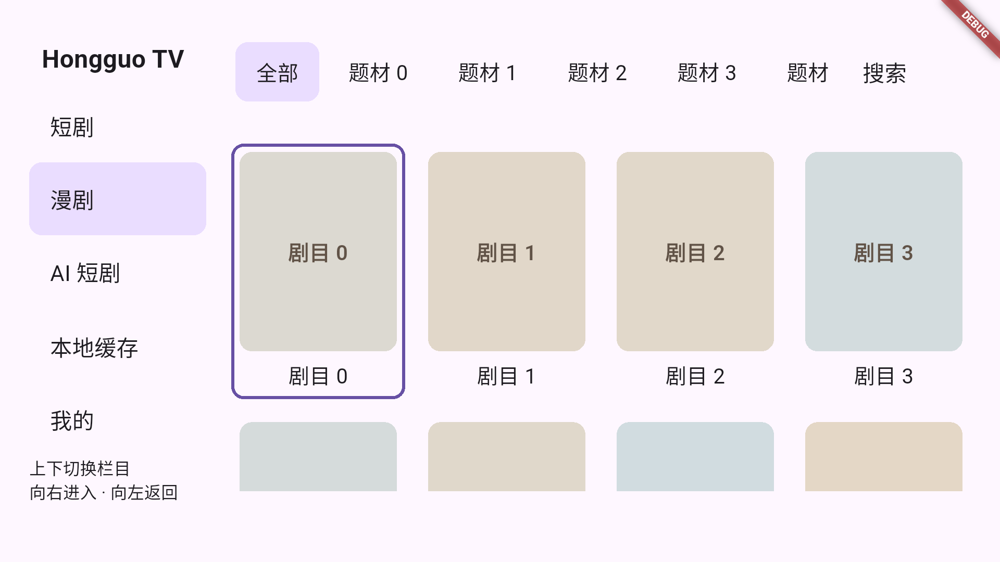
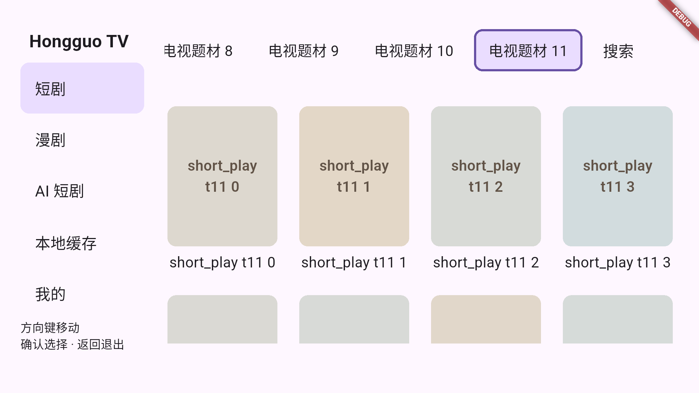
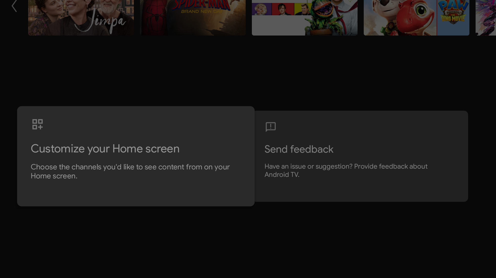

# TV 题材横栏、自动分页与全局排序

日期：2026-10-20。

## 分析与对应修改

原 TV 页面通过弹窗选择题材、手动确认排序，续页依靠按钮；分类请求固定 18 条。PC 已有平铺筛选组，适合复用其选中底色、筛选后刷新和保持页面结构的思路。电视遥控器需要额外处理水平焦点可见性、按键连续输入和后台续页边界。

现在短剧、漫剧、AI 短剧共用同一套 TV 实现：

| 用户要求 | 实际行为 |
|---|---|
| 题材参照 PC 筛选交互 | 题材与搜索同排，搜索固定在最右侧，采用同主题选中底色与 TV 焦点描边，不再打开题材弹窗 |
| 水平展开全部题材 | 全部选项在单行中构建，左右按键直接移动；确认键不是切换条件 |
| 焦点切换后自动加载 | 焦点即选择，220ms 防抖合并连续按键；选中状态立即更新，只加载最终停留项 |
| 焦点标题不能滑出可视区 | 焦点变化后自动滚动水平容器；左右两个方向均有可见范围测试 |
| 排序移入设置、全局共用 | 设置 → 内容列表 → 全局排序；默认热度优先，支持最新上架/收藏最多，三类内容以及 PC/手机分类共用 |
| 自动加载更多、删除按钮 | 接近结果底部或焦点进入尾部两行自动续页，短列表自动补足视口，无“加载更多”按钮 |
| TV 每次 30/50 条 | 设置 → 内容列表 → TV 分类每页条数，默认 30，可选 50，保存后重建目录客户端 |

搜索和榜单继续使用各自接口的排序与游标；TV 分类页大小作用于短剧/漫剧/AI 分类请求，不改变官网搜索返回机制。上游实际返回的条数可能少于请求值，不能把设置值当成服务端条数保证。PC/手机分类请求保留原 18 条。

## 分层与数据正确性

- `packages/tv/lib/src/choice_rail.dart`：独立水平选项栏，使用稳定 ID 和 FocusNode；只输出选择事件，不调用网络。
- `packages/tv/lib/src/grid.dart`：输出接近末尾事件，保持原有屏幕外行定位和卡片焦点。
- `features/tv/tv_library_page.dart`：独立 `RootStackRouter` 与 `AutoTabsRouter`；以 `feed/:id` 的完整路径为路由键，每个类型/题材对应独立、懒加载、保活的页面。路由清单初始化后保持稳定，不因网络刷新重新注册。
- `features/tv/tv_feed_page.dart`：每页独立持有请求代次、列表、分页、设置订阅、滚动和焦点。切回原页面直接显示现有完整列表，220ms 后后台刷新；离开页面停止自动续页和未发出的防抖请求，关闭隐藏页面的动画时钟。
- `features/tv/data/tv_feed_cache.dart`：按类型、题材、搜索词、排序、页大小隔离首屏快照。按 ID 去重并合并元数据，部分响应不抹掉已有封面/简介；未变化的数据对象复用。首屏相同则保留已加载续页及其游标；首屏变化时更新头部并合并已加载尾部，重新校验后续游标。
- `AppSettings.catalogSort` / `tvPageSize`：持久化、旧配置默认迁移、校验和 copyWith；不进入签名协议配置。
- `CatalogClient.browsePageSize`：由原生 Runtime 对 TV 注入 30/50，按实际响应推进游标；接口拒绝大于 50 的配置。
- PC 页移除本地排序入口，读取同一全局设置；设置事件到达时重新请求对应排序，避免页面局部排序覆盖全局值。

各题材的请求只更新其所属页面；同页面旧查询/旧配置响应按代次丢弃，不能追加到当前列表。自动分页对在途任务去重；识别原地/循环游标；连续两页没有新 ID 时停止自动续页，避免服务端异常引起无限请求。续页失败保留现有内容并提供“重试”，不会在滚动事件中反复重试。非当前路由不继续后台自动分页。

TV 无手动加载按钮，自动分页始终生效；设置中原“自动加载下一页”开关继续用于 PC/手机，TV 不显示这个开关，以免关闭后失去续页入口。

## Sidebar 路由与焦点往返

后续跨行与容器边界规则见 [TV 跨行焦点导航方案](tv-cross-row-focus-navigation.md)。其中资源列表的左右连续索引与分页等待已实施；剧集区和上下目标列等其余部分仍为后续设计。

Sidebar 外层采用第二级 `AutoTabsRouter`，五个栏目分别是 `TvShortCatalog`、`TvComicCatalog`、`TvAiCatalog`、`TvLocalCache`、`TvMy`。每个分类内部再用独立的题材 `AutoTabsRouter`；本地缓存和“我的”也保活，不再用条件构建的 `IndexedStack` 重建它们。题材清单按分类懒加载。

焦点操作分为两种意图：

| 操作 | 路由与焦点行为 |
|---|---|
| Sidebar 上/下 | 焦点即激活栏目，不需要确认键；到首尾停止，不绕回 |
| Sidebar 向右 | 恢复当前栏目最近的右侧焦点；失效时先找已选中的控件，避免从首个题材重新开始 |
| 全列表第 0 项向左 | 显式返回当前选中的 sidebar 项；不按控件几何位置猜测栏目 |
| 其他条目向左/右 | 按 Index−1 / Index+1 移动，行首向左进入上一行末，行末向右进入下一行首；横向边界不交给顶部 tab |
| 题材首项向左 | 返回当前栏目；题材内部左右选择仍保持原行为 |
| 左右往返查看 | 不改变栏目、题材、分页和滚动位置，不触发额外刷新请求 |
| 切换栏目后再返回 | 恢复该栏目自己的题材页面和右侧焦点，后台刷新仍按缓存合并规则执行 |

`packages/tv/lib/src/pane_boundary.dart` 定义右侧焦点边界，`TvNavigation` 在边界处调用宿主的返回逻辑。每个 sidebar 页面使用独立 `FocusScopeNode`，页面切换不共享焦点。网格离开边界时使待完成的移动代次失效，避免快速按键后旧任务抢回焦点；右键在分类加载完成前到达时，也会在内容就绪后完成进入。

新增测试覆盖：五个栏目仅靠上下焦点自动切换；漫剧指定题材/卡片与 sidebar 连续三轮往返且请求数不变；切到 AI 再返回仍为原漫剧网格实例；本地缓存和“我的”往返保持同一页面实例。

工作区静态分析通过，完整 App 102 项、TV 模块 20 项通过。Android TV API34 的真实模拟遥控器通道也通过同一场景，日志在 `build/verification/tv-sidebar-device/`，输出：

```text
TV_SIDEBAR_NATIVE_PASS five_routes=true focus_selects=true comic_focus_restored=true lateral_switch_does_not_reload=true
```

设备复现命令：

```bash
GRADLE_OPTS='-Dorg.gradle.internal.instrumentation.agent=false' \
  build/verification/tv-remote-venv/bin/python tool/verify_tv_device.py \
  --device emulator-5554 --input-source emulator \
  --test integration_test/tv_sidebar_interaction_test.dart \
  --output build/verification/tv-sidebar-device
```

本次本机 Gradle/Kotlin 插桩类加载失败，通过构建进程参数关闭 instrumentation agent 后完成构建；不改变应用依赖或用户全局 Gradle 设置。




## 消除闪烁和整页抖动

切换题材直接激活保活页面，不清空其他题材列表，也不重建已访问页面的网格。后台刷新期间保留内容，只有字段变化时更新卡片文字，并用 180ms 局部淡入淡出；不对整个页面做淡出再淡入。

网格加载/错误提示预留固定 40 高度，搜索说明固定 28 高度，避免状态改变时重新计算网格高度。`TvFocusable` 只滚动最近的容器，并采用 keep-visible 策略；取消原来每次聚焦强制居中及向外层 Scrollable 传播。网格跨行只移动超出视口所需的距离，不再先对齐行顶、再由焦点二次滚动；卡片按剧目 ID 保持元素身份。

最新回归：App 102 项、TV 模块 20 项通过。新增测试实际验证：切回题材仍为同一网格实例，滚动 offset 与已加载页数不变；后台更新不改变网格矩形；可视行内左右移动不改变 offset。硬件遥控验证见 `build/verification/tv-routes-device/`，连续 12 个题材与自动分页通过。以下为此前版本的基础验证记录。

## 验证记录

- Core：116 项通过，含旧设置迁移、全局排序与 30/50 值校验。
- API：34 项通过，含 30/50 请求 limit、部分响应与游标推进。
- TV 模块：10 项通过；水平栏测试覆盖 20 次向右及 19 次向左，焦点项均在视口内；现有遥控/播放状态测试同时回归。
- App：完整回归 91 项通过；TV 设置专项 1 项通过。覆盖三类内容焦点切换、快速移动合并、自动分页、失败重试、无增长停止、旧页丢弃、全局排序生效。
- TV 设置专项：实际选择收藏最多和 50 条后保存，配置仍符合共享存储格式。
- Native Runtime TV 设置专项：7 项通过，验证保存后新目录客户端的 browsePageSize 为 50。
- Android TV API34 模拟器：真实模拟遥控器硬件通道，连续移动 12 个题材，无需确认，每次选中项都自动发起对应加载；随后向下浏览触发一次自动续页。原生测试输出：

```text
TV_FEED_NATIVE_PASS focus_selects_without_ok=true themes=12 label_visible=true automatic_page=true
00:47 +1: All tests passed!
```

设备测试使用本地确定性数据，避免把上游变化混入交互验收。正常入口部署后另保存实际页面截图。物理电视及真实上游所有题材/机型组合仍需独立验收。





## 运行与复现

```bash
./tool/verify_tv.sh
build/verification/tv-remote-venv/bin/python tool/verify_tv_device.py \
  --device emulator-5554 --input-source emulator \
  --test integration_test/tv_catalog_interaction_test.dart \
  --output build/verification/tv-feed-device
```

测试输出在 `build/verification/tv-feed-device/`。硬件控制依赖与 AVD 配置要求见 [遥控器修复记录](../android-tv-remote-fix.md)。测试入口结束后，使用 `lib/main.dart` 重建/恢复正常 TV App。

## 正常入口与安装包

已重建并安装正常 TV 入口，模拟器保持运行。试装包：`artifacts/android-tv/Hongguo-0.2.7-tv-arm64-debug.apk`。以下为真实目录界面，前面的遥控自动化截图使用固定夹具。


