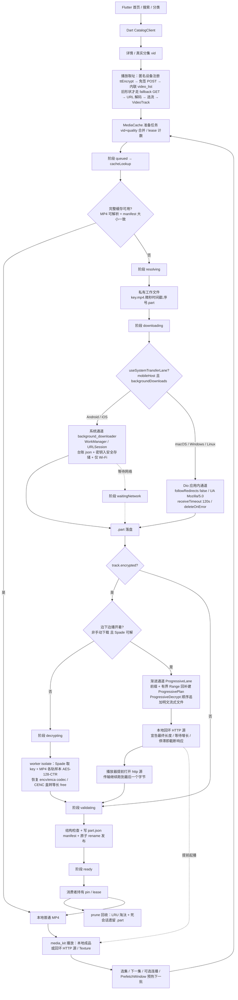
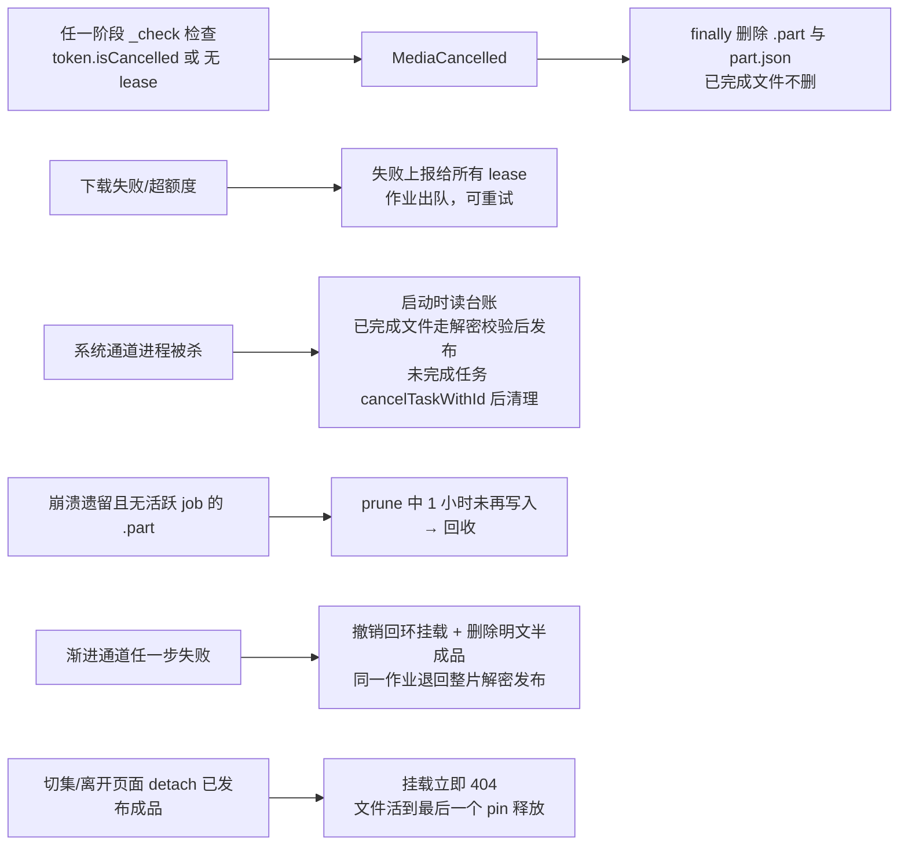

# 第二阶段：共享 Dart 核心到本地播放器

> 文档与源码目录见 [项目索引](README.md)；已有验收结果的持久化快照见 [证据索引](evidence/README.md)。

本报告保留第二阶段离线验证记录。最新的当前 Mac 真实单集与独立 Release 验收见 [Mac POC 报告](macos-independent-app-poc.md)。

2026-10-28 更新：链路图补齐播放取址、双下载通道分派、缓存回收与异常恢复路径，并新增「为什么 macOS 曾经无法加载在线视频」一节。

2026-11-02 更新：新增「边下边播：渐进解密与本地回环源」一节与对应链路分支（默认关闭），同时修掉 Windows 下缓存身份按路径字符串比较的旧账（详见「下载、并发和缓存一致性」）。

日期：2026-10-19。实现位置：`packages/core`、`packages/api`、`packages/app`。本文取代初步验证报告中的“尚未实现 MP4/播放器”状态；初步报告保留为第一阶段历史记录。

## 已落地的实际链路



### 异常与恢复路径



### 边下边播：渐进解密与本地回环源（2026-11-02）

要解决的问题：加密剧集必须等「整片下载完 + 整片解密完」才出第一帧，弱网下这段等待被用户读成「加载不出来」。

不能把 `.part` 直接交给播放器，原因有两条：上游给的是 CENC 密文，media_kit 只会读本地明文文件或明文 HTTP 源；尾部 moov 的形状在明文样本之前根本没有可解析的索引。于是链路分成三步：

1. **计划早建**。`Mp4Cenc.inspect` 只读顶层盒的 16 字节头和 moov 本体，不读 mdat 负载，所以「已下载的前缀 + 一次有界 Range 回补 moov」就足够算出 `ProgressivePlan`：逐样本表、每片的覆盖水位、moov 补丁与偏移增量。此时文件可能只有开头几十 KB。
2. **顺序追加**。`ProgressiveDecrypt.pump(已收字节)` 按片序把明文写进流式文件——`-1` 原样拷贝、`>=0` 单样本 AES-128-CTR、`-2` 写重定位后的 moov、`-4` 原地改写头部 moov、`-3` 收尾哨兵。尾部 moov 被搬到 mdat 之前并重算 stco/co64（等效 faststart），整片字节数守恒；覆盖不足的样本原地等待，绝不跳写，所以输出前缀始终连续，可以直接对外做 Range。
3. **回环供给**。本机 127.0.0.1 上挂一个只读这个增长文件的源，宣告最终长度、按已解密前缀响应 `Range`，增长停滞超过 20 秒就把响应截断让播放器重连。播放器因此能按普通 HTTP 视频打开一个还在变长的地址。

起播点与安全边界：

- 计划算出的 `metadataEnd`（头部盒 + 重定位 moov + 首批样本）就是可解码前缀的下界，达到之后 `MediaPreparation.early` 才交出一个 URL；缓存命中、非加密轨、手动下载、TV、画中画交接与离线入口一律返回 null，播放器照旧等整片文件。
- 传输报告的已收字节只是提示：Dio 与系统通道的写入端都会缓冲，`pump` 取「已收」与「文件实际长度」的较小值，晚几毫秒落盘的字节不会把已经在播的流判成失败。
- 最后一个字节会强制一轮 `downloadComplete` 的 pump，让 `-3` 哨兵落盘；只有 `writer.completed` 为真才允许发布。
- 发布口径不变：结构检查 + manifest + 原子改名，密文工作文件在发布点当场退役。渐进通道任何一步失败就撤销挂载、删掉半成品并退回整片链路，缓存命中的判定仍然只认完整成品。
- 明文流式文件与密文工作文件会同时存在，这一集的瞬时占用约翻倍；播放页在传输中途断掉时提示「本集下载未完成，播放可能在结尾中断」，而不是把已经在屏的画面推翻。
- pump 在主 isolate 上按 64 KB 分批写并主动让出事件循环，避免解密堵住 UI 与下载回调；这不是吞吐优化，是共存约束。

### 为什么 macOS 曾经「无法加载在线视频」

原因链是一条通路，不是解码器问题：

1. 开关语义在不同平台落到不同实现。`backgroundDownloads` 打开时，[native_downloads.dart:142](../packages/app/lib/platform/background/native_downloads.dart#L142) 把传输交给 `background_downloader`；该包在 9.6.4 里没有 `macos/` 原生目录，`file_downloader.dart:20` 的条件导入使桌面落到 `lib/src/desktop/desktop_downloader.dart`——一个纯 Dart isolate 自建队列，没有系统下载器的停滞检测。
2. 该实现会在同一 URL 上停在固定字节，既不抛错也不触发 `receiveTimeout`，除 `running`/`complete` 外没有任何状态回调，因此 `bg.FileDownloader().transfers.start(...)` 永不返回。
3. 卡住的作业继续占用 `concurrentPreparations` 的两个槽，后续集的 `MediaCache.prepare` 只会被取消，`MediaStage.ready` 永不发布。
4. UI 侧 `switchStages` 停在「正在下载」，播放器已按 vid 建好 `VideoOutput` 与 NativeVideoController 纹理，但没有可读的本地文件，`VideoOutput.Resize` 的 rect 一直是 `0×0`；只有此前已缓存成功的那一集出现过 `TextureGL: resize: 1920.0x1080.0`。
5. 附带放大问题：`prune()` 过去只按 `.mp4` 统计与淘汰，`finally` 只在同进程内清理工作文件，进程被杀留下的 `.part` 永不回收，缓存目录堆积不可解密密文，进一步挤掉自动缓存额度。

修复即断开这条链：桌面固定留在应用内 Dio 通道（第 1 步），`prune()` 回收无主且超过 1 小时未写入的 `.part`（第 5 步）。实机前后读数与日志见 [mac 下载通道证据](evidence/mac-download-lane-2026-10-28/findings.md)，完整分析见 [macOS 与移动端播放差异](analysis/2026-10-28-mac-vs-mobile-playback.md)。

原生路径不运行 Node、不调用旧本地 `/stream` 服务、不使用 ffmpeg 子进程。ffmpeg 只在开发机生成离线测试样本和辅助验证结果；App 使用纯 Dart 处理容器与样本。

## Flutter UI

- 首页：桌面侧栏与移动布局、短剧/漫剧/AI短剧切换、热度/最新/收藏排序、上游题材筛选、刷新、分页、错误重试与空态。
- 搜索：剧名搜索、官网 SSR 优先、App 回退、游标翻页；页面用请求代数丢弃旧响应，避免快速切换后的旧列表覆盖新列表。
- 详情：封面、简介、分集列表与开始观看。
- 播放：原生 Video texture、下载/处理状态、清晰度、全屏控件、上一集/下一集、自动连播、下一集预热、失败重试；离开页面取消准备并在播放器关闭后释放缓存 pin。
- 设置：「边下边播」独立开关，默认关闭，说明文字直说它会为当前这一集临时多占约两倍空间；TV 端不出现这一项。
- 缓存面板：统计本地成品大小，清理未使用文件，保护正在播放的文件。
- 离线检查：保留第一阶段签名/摘要自检，入口在首页工具栏。
- 音频输出设备故障独立提示，不把仍可解码的视频画面覆盖为整个播放失败。

UI 不假设取址成功等于能播放。只有播放器实际读取本地文件才进入播放过程，解码错误仍会显示；重试时可移除上次失败的缓存。

## 内容接口

`CatalogClient` 使用 Dio，明确签名的 query 顺序、UTF-8 body 和 MD5 stub，设备身份在 App 私有支持目录持久化。列表与搜索/详情都签名（2026-10-21 起默认开启）。AppClient 与视频取址客户端保留不同的上游主机和版本参数。播放取址自 2026-10-28 起不再带签名：先向 log 域名注册匿名播放设备（ttEncrypt），复用其 `device_id`/`iid`，用播放器自身的 User-Agent 发免签 POST。

| 能力 | 上游与处理 |
|---|---|
| 分类/排序/题材 | landpage；genre 映射 req_scene/select_items；带 filter_ids 去重 |
| 实时题材 | landpage selector_rows |
| 搜索 | 官网 searchList SSR，正确 await HTML；无结果/失败时 App 搜索；保存上游 offset/passback/search_id 游标 |
| 分集 | App multi_video_detail/preload；空详情/异常时正确 await 官网 vid_list 回退 |
| 播放模型 | Dart VideoModelClient；匿名设备注册 → 免签 POST → 内联 video_list（旧形状才走 fallback GET）→ URL 解码 → 选流 |

ID 始终使用字符串。App 详情缓存 6 小时、最多 100 条。没有复制原项目“刷新登录态”的空操作，也没有声称能替用户取得登录态。官网或上游改版仍可能使真实搜索/取址失败，本次线上可用性未验证。

## MP4/CENC 核心

`mp4.dart` 是纯 Dart；`hongguo_native.dart` 提供随机访问文件适配与 isolate 入口。只把 moov 和单个样本加载到堆，不把整部视频读入内存。

已支持：

- 头部/尾部 moov；32/64 位盒大小与 stco/co64 chunk 偏移。
- stsz/stsc/stsd，单轨一个 sample description，逐样本大小与文件偏移展开。
- 视频/音频轨；tenc/senc 8 字节与 16 字节 IV。
- CENC AES-128-CTR 整样本与 subsample 清晰/加密区段；同一样本内 encrypted 区段连续消耗同一 CTR 状态，clear 区段不消耗密钥流。
- 现有 Hongguo 合成样本的 compact tenc 布局，以及开发机 ffmpeg 生成的标准 CENC 布局。
- 密钥/视频样本 NAL 结构预检、样本必须在 mdat 内、拒绝样本重叠、截断/无效盒长和过大的内存请求。
- encv/enca 按 frma 恢复原始 codec；sinf/senc/saiz/saio/pssh 替换为等长 free 盒，所有 chunk 偏移不变。不是简单搜索字节串替换，也无需重新复制 mdat。

明确未支持：fragmented MP4/moof、CBCS/pattern encryption、constant IV、只有外部 saiz/saio IV 而没有 senc 的形式、stz2、单轨多个 sample description、Spade v2。遇到这些形式明确失败，不发布为 ready 缓存。

**验证的边界**：CENC 没有消息认证；标准 subsample 的 NAL 头往往是明文。因此 NAL 结构检查不是密钥真实性的完整证明。整样本错误 key 的测试验证了“写入前拒绝”；subsample 的最终语义正确性由逐样本真值对比和实际解码验证，不能把结构检查说成认证。

## 下载、并发和缓存一致性

- 传输通道按平台分派：桌面（macOS/Windows/Linux）固定使用 Dio 流式落盘；移动端仅在「后台下载」打开时交给系统下载器，关闭时同样走 Dio。两条通道写同一个私有 `.part`，之后的解密/校验/发布完全共用。
- 下载总大小不会作为一个完整响应 Buffer 留在 Dart 堆中；Dio 通道有 `receiveTimeout: 120s`、`followRedirects: false` 和 `deleteOnError`，系统通道用台账 + 安全存储密钥跨进程恢复。
- 每个 vid+quality 合并一个任务；每个消费者独立持有 lease，取消一个消费者不会破坏另一个消费者。
- 准备流水线串行执行，避免多部视频并发解密挤占手机内存；播放器可同时读取已完成文件。
- CancelToken 取消下载；对正在解析/解密的 isolate，取消后不会发布结果，待阶段结束清理私有工作文件。
- 只有“可解析为普通 MP4 + 原子重命名 + 完整 manifest”才命中缓存；崩溃残留、半成品、被截断文件不会作为 ready。
- 默认保留最近 30 个成品，访问更新修改时间；正在使用的文件 pin 保护，允许暂时超过目标上限。
- 播放错误后重新准备可淘汰坏缓存；文件关闭后才释放 pin，兼容 Windows 的打开文件语义。
- 边下边播的作业和普通作业共用同一把 vid+quality 键、同一个 lease 计数与同一套发布条件；渐进通道只在「加密轨 + 自动预热或主动播放 + 设置开启 + Spade 可解」时建立，手动下载（`job.manual`）仍走整片链路，避免同一集同时占两份空间。回环源的挂载活到最后一个 pin 释放为止。
- 缓存身份按文件名比较，不按路径字符串比较：`Directory.list()` 在本机给 `\`、代码里拼接给 `/`，字符串相等判断在 Windows 上会静默失效。这条旧账原先让 `entries()` 列不出成品、`prune()`/`clear()` 认不出正在播放的文件——现在 pin 保护与清单枚举都以 basename 为准，`tool/verify_all.sh` 在 Windows 门禁下同样可信。
- 清理只针对自身缓存目录的成品/manifest，不扫描用户其他文件；`prune()` 同时回收没有任何活跃任务、且超过 1 小时未再写入的 `.part` / `.part.json`，避免进程被杀后遗留的不可用密文长期占额度。正在传输的工作文件落在该时间窗内，不会被误删。

## 跨平台适配

原生五端调用同一份 Dart 核心，平台插件仅负责私有目录与播放输出。Android 已加 INTERNET 权限；macOS sandbox 已加 network.client；iOS 配置 playback/moviePlayback 音频会话。

浏览器保留独立远程适配，构建时传 `--dart-define=HONGGUO_API_BASE=https://your-service`，使用已有 API 文档描述的服务。浏览器不尝试使用 dart:io 或直接带 App UA/签名头绕过浏览器网络限制。Web 远程服务未配置时有明确提示。

播放器依赖参考 [media_kit 官方说明](https://pub.dev/packages/media_kit)、[media_kit_video](https://pub.dev/packages/media_kit_video)，目录插件参考 [path_provider](https://pub.dev/packages/path_provider)。iOS 音频会话配置依据 [Apple 媒体播放文档](https://developer.apple.com/documentation/avfoundation/configuring-your-app-for-media-playback)。平台支持声明与本机实际测试结果分开记录。

## 复现与证据

```bash
./tool/verify_all.sh
./tool/verify_native.sh macos
```

`verify_all.sh` 执行所有单测、widget 测试、签名 AOT/JS 对拍和 Dart 媒体解密验证；开发机装有 ffmpeg/ffprobe 时增加真正的视频/音频解码检查。原生集成测试另行运行，以免单元测试时自动启动或安装设备应用。

若需重新生成本地媒体样本（无需外网/真实剧集）：

```bash
node tool/generate_media_fixtures.cjs /Users/lee/Downloads/hongguo-web-1.1.1-macOS-arm
```

| Evidence | Finding | Path |
|---|---|---|
| `packages/core/test/mp4_test.dart` | 音视频逐样本与清晰原文件一致；错误整样本 key 不改写数据；坏表失败 | CENC → Dart parser/CTR → 普通 MP4 |
| `packages/core/test/progressive_decrypt_test.dart` | 尾部 moov 边下边解：输出可再解析为普通 MP4、moov 前置、字节守恒、逐样本与整片解密一致；head-moov 恒等；停滞只暴露连续前缀并能原地续上 | 前缀 → ProgressivePlan → 顺序追加 → 再解析 |
| `packages/api/test/progressive_lane_test.dart` | 计划可由极小前缀 + 有界 Range 回补建立；宣告的流经 HTTP 可播并收尾为完整明文；未加密/长度变化/超预算提前放弃；discard 撤挂载、detach 留成品 | 密文工作文件 → 通道 → 本地源 |
| `packages/api/test/progressive_stream_server_test.dart` | 只绑回环且路径带令牌；HEAD 宣告最终长度；Range 出 206、越界 416；停滞按连续前缀截断；等待期间文件变长即可继续 | 增长的明文文件 → HTTP 语义 |
| `packages/api/test/progressive_media_cache_test.dart` | 真实 `MediaCache` 端到端：传输暂停中即拿到可播 URL、已服务字节与成品头部一致、发布到最终缓存名、重开缓存直接命中且不再联网、关闭设置退回整片、取消不留 `.part` 与挂载 | cache → 通道 → 本地源 → 发布 |
| `packages/api/test/media_cache_test.dart` | 下载/解包/解密/重启命中、独立取消、失败重试、pin 保护、prune 回收死会话 `.part` | Dio mock → worker → manifest/cache |
| `packages/app/test/native_download_lane_test.dart` | 通道谓词只在移动端为真；macOS 覆盖下打开「后台下载」仍由应用内 Dio 完成真实 HTTP 下载 | 平台判定 → HttpServer → 文件字节一致 |
| `packages/app/integration_test/macos_live_poc_test.dart`（`tool/verify_mac_live.sh`） | 真实上游在线选集：预缓存 N 集就绪、出帧、seek、切集阶段不再出现「正在下载」 | mac Release 容器 → 取址 → Dio → 解密 → media_kit |
| `packages/api/test/catalog_test.dart` | 官网 async 契约、AI 分类参数、ID 字符串、详情回退 | UI Repository → Dio/HTML |
| `packages/app/test/widget_test.dart` | 窄屏/桌面、搜索分类、详情、重试/分页 | Flutter UI → fake repository |
| `packages/app/integration_test/offline_playback_test.dart` | 真实原生播放器读取本地解密文件、识别视频/AAC、seek 与退出 | 目录/选集 → cache → Dart decrypt → media_kit |
| `build/verification/media-summary.json` | 84 个样本已解密，剩余加密样本 0 | 18 视频 + 66 音频样本 |
| `build/verification/ffprobe-media.json`、`ffmpeg-decode.log` | 输出识别为 H.264 160×288 + AAC，开发机完整解码检查无错误 | Dart 输出 → 独立解码器 |

测试素材是本地生成的 1.5 秒测试图和正弦音，不是真实剧集下载。真实上游、真实内容和手机性能需独立验收。当前执行结果和截图见 `build/verification/`；更新后的测试/构建汇总见 `phase2-summary.json`。

## 本次执行结果

| 项目 | 结果 |
|---|---|
| 静态分析 | `dart analyze --fatal-infos` 无问题 |
| 核心 / API / Flutter 页面 | 111 / 19 / 4 项全部通过 |
| 签名跨编译验证 | AOT 与 dart2js 各 103 个正向向量通过 |
| macOS 原生集成 | 视频实际解码、AAC 轨识别、seek、退出通过；音频输出无错误 |
| iOS 27 模拟器集成 | 视频实际解码、AAC 轨识别、seek、退出通过；模拟器声音设备初始化失败，UI 明确提示降级，未验证真机声音输出 |
| Web release / macOS debug / Android debug APK | 均构建成功 |
| 独立解码验证 | ffprobe 识别 H.264/AAC，ffmpeg 完整解码无错误 |

macOS 原生测试提取了实际解码帧和 Flutter 首页/详情截图。截图使用明确标注的离线测试目录数据，不能当作线上搜索成功的证据。

- [首页截图](../build/verification/hongguo-library-ui.png)
- [详情截图](../build/verification/hongguo-detail-ui.png)
- [播放器解码帧](../build/verification/hongguo-native-frame.png)
- [Dart 解密后的普通 MP4](../build/verification/offline-decrypted.mp4)

Android、Windows、Linux 的代码/平台适配已存在；不据此声称完成各端真机播放验收。Android 调试包已构建成功：`packages/app/build/app/outputs/flutter-apk/app-debug.apk`。未向连接的实体手机安装测试应用。

## 2026-11-02 边下边播本轮执行结果（Windows 开发机）

本机是 ARM64 Windows，media_kit 只提供 x64 原生产物，因此本轮只跑纯 Dart 与 widget 测试；原生容器内的真实边下边播要在 Mac 与 x64 CI 上另行验收。

| 项目 | 结果 |
|---|---|
| 静态分析 | `dart analyze --fatal-infos` 对 `packages/core`、`packages/api` 与 `packages/app` 的 `lib`+`test` 均无问题 |
| `packages/core` | 125 项全部通过（含新增 `progressive_decrypt_test.dart` 8 项） |
| `packages/api` | 139 项全部通过（含新增渐进用例 30 项）；同机 HEAD 基线是 10 项失败，差额是本轮修掉的 Windows 缓存身份旧账与测试清理竞争 |
| `packages/app` | 424 通过 / 1 跳过 / 3 失败；3 项全在 `tv_feed_test.dart`，把并行进行中的未提交改动单独叠加到 HEAD 后同样复现，与本功能无关 |
| 渐进链路 | 传输暂停中即可拿到可播 URL、已服务字节与成品头部逐字节一致、发布后重启命中且不再联网、关闭开关退回整片、取消不留 `.part` 与挂载 |

未验证的边界（不要当成已验收）：真实上游剧集的边下边播起播耗时与卡顿率、Mac/移动端 media_kit 对增长中 HTTP 源的实际 seek 行为、约翻倍的瞬时磁盘占用对低端机的影响，以及 TV/画中画路径之外的分支组合。这些都还只有离线夹具与单元/集成级证据。
